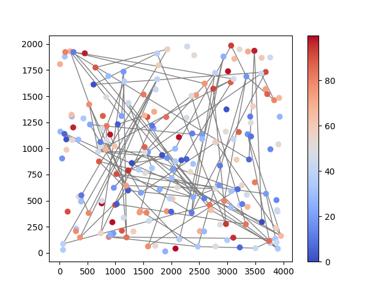
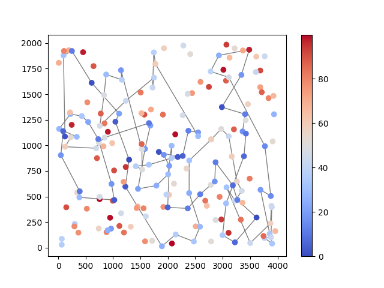
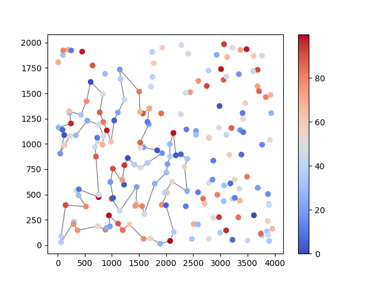
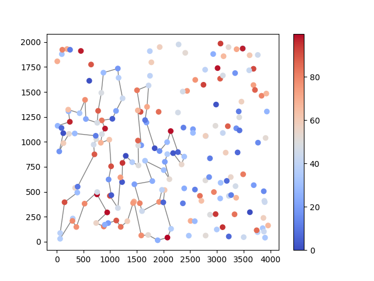
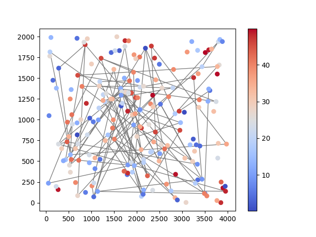
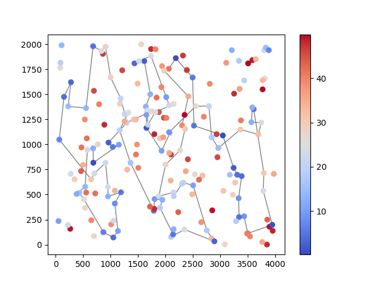
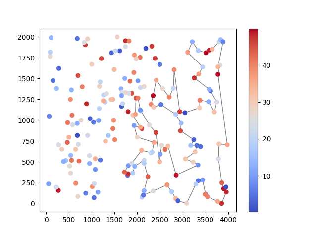
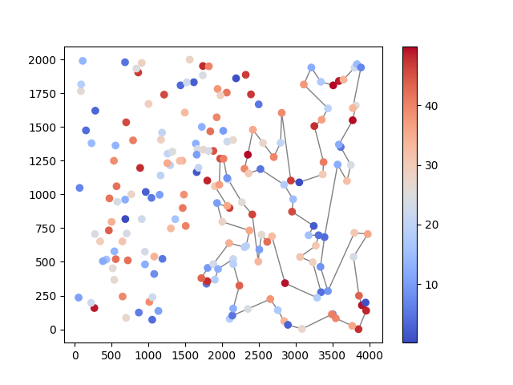

## Problem description

We are given three columns of integers with a row for each node. The first two columns contain x
and y coordinates of the node positions in a plane. The third column contains node costs. The goal is
to select exactly 50% of the nodes (if the number of nodes is odd we round the number of nodes to
be selected up) and form a Hamiltonian cycle (closed path) through this set of nodes such that the
sum of the total length of the path plus the total cost of the selected nodes is minimized.

The distances between nodes are calculated as Euclidean distances rounded mathematically to
integer values. The distance matrix should be calculated just after reading an instance and then only
the distance matrix (no nodes coordinates) should be accessed by optimization methods to allow
instances defined only by distance matrices.

## Algorithms

### Nearest Neighbor

```
Input: 
matrix - matrix of distances between nodes
costs - array of node costs

to_find = ⌈len(matrix) / 2⌉
indices = [i for i∊ℕ and i<len(matrix)]

solution = [random.choice(indices)]
while len(solution) < to_find:
    possible_next = indices\solution
    next = argmin[x∊possible_next](matrix[solution[-1]][x] + costs[x])
    solution.append(next)
```

### Nearest Neighbor considering adding the node at all possible positions

```
Input: 
matrix - matrix of distances between nodes
costs - array of node costs

to_find = ⌈len(matrix) / 2⌉
indices = [i for i∊ℕ and i<len(matrix)]

function get_insert_cost(solution, node, idx):
    if len(solution) == 1 or len(solution) == idx + 1:
        return matrix[solution[-1]][node] + costs[node]
    return costs[node] + matrix[solution[idx]][node] + matrix[node][solution[idx+1]] - matrix[solution[idx]][solution[idx+1]]

solution = [random.choice(indices)]
while len(solution) < to_find:
    possible_next_node = indices\solution
    possible_inserts = [(node, index) for node in indices for index∊ℕ and index<len(solution) and index∉solution]
    # All inserts after idx
    next = argmin[x∊possible_inserts](get_insert_costs(solution, x[0], x[1]))
    # Insert at the beginning
    beginning_next = argmin[x∊possible_next_node](cost[x] + matrix[x][solution[0]])
    
    if get_insert_cost(solution, next[0], next[1]) < costs[beginning_next] + matrix[beginning_next][solution[0]]:
            solution.insert(next[1] + 1, next[0])
        else:
            solution.insert(0, beginning_next)
```

### Greedy cycle

```
Input: 
matrix - matrix of distances between nodes
costs - array of node costs

to_find = ⌈len(matrix) / 2⌉
indices = [i for i∊ℕ and i<len(matrix)]

function get_insert_cost(solution, node, idx):
    if len(solution) == 1 or len(solution) == idx + 1:
        return matrix[solution[-1]][node] + matrix[node][solution[0]] + costs[node]
    return costs[node] + matrix[solution[idx]][node] + matrix[node][solution[idx+1]] - matrix[solution[idx]][solution[idx+1]]

solution = [random.choice(indices)]
while len(solution) < to_find:
    possible_next_node = indices\solution
    possible_inserts = [(node, index) for node in indices for index∊ℕ and index<len(solution) and index∉solution]
    # All inserts after idx
    next = argmin[x∊possible_inserts](get_insert_costs(solution, x[0], x[1]))
    # Insert at the beginning
    beginning_next = argmin[x∊possible_next_node](cost[x] + matrix[x][solution[0]] +  matrix[solution[-1]][x])
    
    if get_insert_cost(solution, next[0], next[1]) < costs[beginning_next] + matrix[beginning_next][solution[0]] matrix[solution[-1]][beginning_next]:
            solution.insert(next[1] + 1, next[0])
        else:
            solution.insert(0, beginning_next)
```


## Results

|  | Random solutions | Nearest neighbor | Nearest neighbor (all positions) | Greedy cycle |
| --- | --- | --- | --- | --- |
| **Instance A** |
| Min | 225267 | 84362 | 107908 | 108734 |
| Avg | 261519.96 | 87457.88 | 109954.945 | 112436.94 |
| Max | 290575 | 89933 | 113841 | 129808 |
| *Execution time* | 2.93ms | 947.68ms | 76415.7ms | 74736.5ms |
| **Instance B** |
| Min | 178305 | 56007 | 135098 | 135631 |
| Avg | 207024.785 | 59485.015 | 138160.42 | 139849.3 |
| Max | 231261 | 63166 | 142466 | 163788 |
| *Execution time* | 3.09ms | 949.7ms | 76687.14ms | 102721.43ms |

## Instance A

### Random

Min: 225267

Avg: 261519.96

Max: 290575

Best solution: [12, 141, 90, 162, 44, 148, 7, 93, 79, 107, 116, 58, 136, 181, 23, 130, 78, 13, 129, 112, 110, 141, 66, 160, 184, 140, 22, 106, 123, 71, 76, 7, 34, 124, 187, 145, 72, 78, 156, 156, 30, 186, 84, 141, 152, 9, 62, 51, 92, 157, 183, 132, 196, 84, 23, 112, 120, 97, 175, 137, 13, 4, 185, 27, 192, 64, 153, 32, 192, 178, 0, 26, 140, 84, 58, 86, 80, 115, 165, 109, 184, 48, 65, 88, 3, 26, 8, 87, 191, 52, 197, 178, 6, 101, 180, 144, 160, 156, 84, 72]



Run time: 2.93ms

### NN

Min: 84362

Avg: 87457.88

Max: 89933

Best solution: [54, 9, 33, 36, 177, 67, 144, 53, 135, 58, 134, 176, 174, 106, 89, 107, 57, 182, 151, 93, 50, 3, 1, 164, 178, 29, 136, 186, 184, 47, 159, 130, 153, 78, 88, 193, 170, 146, 75, 64, 150, 42, 113, 43, 85, 142, 8, 131, 84, 158, 192, 181, 114, 141, 180, 132, 76, 80, 48, 31, 63, 149, 168, 97, 127, 187, 30, 123, 152, 108, 60, 116, 49, 11, 119, 160, 83, 90, 51, 16, 35, 87, 45, 140, 52, 179, 185, 28, 102, 156, 157, 71, 91, 38, 100, 4, 112, 139, 115, 5]\



Run time 947.68ms

### Nearest neighbor considering adding the node at all possible position

Min: 107908

Avg: 109954.945

Max: 113841

Best solution: [157, 71, 4, 76, 132, 162, 68, 44, 14, 38, 80, 66, 108, 82, 60, 167, 116, 149, 63, 168, 119, 11, 49, 152, 100, 90, 148, 83, 123, 160, 12, 161, 125, 97, 95, 127, 120, 188, 129, 104, 69, 94, 110, 92, 32, 171, 2, 198, 166, 183, 10, 22, 25, 114, 118, 181, 135, 121, 61, 73, 41, 84, 99, 131, 36, 177, 74, 52, 179, 53, 140, 45, 98, 70, 96, 27, 87, 189, 40, 187, 30, 23, 141, 145, 191, 180, 28, 102, 185, 144, 67, 35, 156, 172, 16, 51, 133, 173, 196, 18]



Run time 76415.7ms

### Greedy cycle

Min: 108734

Avg: 112436.94

Max: 129808

Best solution: [14, 100, 152, 66, 108, 82, 60, 167, 116, 149, 63, 168, 119, 11, 49, 123, 83, 160, 12, 97, 95, 127, 188, 129, 104, 69, 94, 110, 120, 161, 125, 198, 92, 32, 171, 2, 166, 183, 10, 96, 27, 22, 25, 114, 118, 181, 135, 61, 73, 121, 98, 70, 87, 45, 185, 140, 41, 53, 179, 177, 99, 131, 36, 74, 52, 144, 67, 16, 51, 133, 139, 18, 173, 196, 35, 172, 156, 102, 28, 180, 191, 141, 145, 189, 40, 187, 30, 23, 162, 148, 90, 68, 44, 132, 76, 4, 71, 157, 91, 38]



Run time 74736.5ms

## Instance B

### Random

Min: 178305

Avg: 207024.785

Max: 231261

Best solution: [15, 86, 123, 139, 73, 21, 136, 31, 84, 167, 89, 99, 112, 178, 102, 115, 153, 151, 59, 49, 137, 141, 187, 81, 62, 7, 29, 172, 134, 160, 146, 6, 131, 44, 35, 31, 133, 128, 106, 87, 167, 5, 149, 7, 8, 126, 130, 92, 189, 126, 181, 1, 177, 197, 133, 89, 162, 114, 196, 188, 45, 14, 12, 46, 104, 176, 63, 82, 73, 49, 185, 184, 197, 168, 48, 25, 98, 192, 168, 142, 134, 173, 166, 195, 148, 191, 6, 154, 87, 195, 178, 136, 2, 64, 39, 38, 136, 182, 76, 14]



Run time 3.09ms

### NN

Min: 56007

Avg: 59485.015

Max: 63166

Best solution: [32, 89, 57, 76, 54, 127, 129, 90, 153, 20, 14, 2, 110, 118, 56, 114, 196, 10, 148, 143, 78, 192, 162, 104, 185, 184, 3, 151, 69, 172, 133, 120, 96, 121, 198, 48, 72, 46, 86, 117, 160, 136, 8, 21, 154, 140, 47, 170, 125, 177, 6, 132, 29, 197, 175, 134, 45, 60, 40, 71, 155, 97, 115, 180, 65, 28, 149, 145, 158, 116, 147, 42, 50, 130, 30, 183, 38, 64, 85, 59, 167, 51, 87, 179, 82, 88, 171, 99, 67, 24, 34, 181, 152, 73, 98, 27, 135, 75, 79, 156]



Run time 949.7ms

### Nearest neighbor considering adding the node at all possible position

Min: 135098
Avg: 138160.42
Max: 142466
Best solution: [131, 56, 118, 68, 100, 110, 112, 23, 93, 9, 188, 2, 14, 20, 74, 17, 171, 39, 99, 163, 88, 87, 82, 179, 126, 181, 152, 167, 51, 85, 101, 107, 59, 73, 25, 34, 24, 11, 98, 151, 22, 111, 122, 173, 109, 137, 184, 3, 27, 35, 31, 67, 66, 119, 84, 186, 153, 182, 150, 52, 129, 90, 80, 127, 106, 192, 162, 76, 135, 75, 0, 79, 185, 144, 104, 77, 159, 54, 78, 41, 10, 143, 148, 114, 196, 12, 18, 187, 194, 190, 70, 199, 165, 169, 81, 94, 105, 139, 61, 193]



Run time 76687.14ms

### Greedy cycle

Min: 135631

Avg: 139849.3

Max: 163788

Best solution: [143, 148, 114, 196, 193, 61, 139, 105, 94, 81, 169, 165, 199, 70, 190, 194, 187, 18, 12, 41, 78, 54, 159, 77, 104, 144, 185, 79, 0, 75, 135, 76, 162, 192, 106, 127, 80, 129, 52, 150, 182, 20, 74, 186, 84, 119, 66, 67, 31, 35, 27, 3, 184, 137, 109, 173, 122, 111, 22, 151, 98, 11, 24, 34, 25, 73, 59, 107, 101, 85, 51, 167, 152, 181, 126, 179, 82, 87, 88, 163, 99, 39, 171, 17, 188, 2, 9, 93, 23, 112, 110, 100, 68, 118, 131, 56, 14, 153, 90, 10]



Run time 102721.43ms


## Conclusions

Out of the three algorithms, regular nearest neighbor finds solutions the fastest and it seems to find the best solutions.


## Source code

[https://github.com/WikiDrabinka/ce/tree/main/1](https://github.com/WikiDrabinka/ce/tree/main/1)