# Lab 3 Report

Wiktoria Drabińska 160294, Wojciech Dudziński 160293

## Problem description

We are given three columns of integers with a row for each node. The first two columns contain x
and y coordinates of the node positions in a plane. The third column contains node costs. The goal is
to select exactly 50% of the nodes (if the number of nodes is odd we round the number of nodes to
be selected up) and form a Hamiltonian cycle (closed path) through this set of nodes such that the
sum of the total length of the path plus the total cost of the selected nodes is minimized.

The distances between nodes are calculated as Euclidean distances rounded mathematically to
integer values. The distance matrix should be calculated just after reading an instance and then only
the distance matrix (no nodes coordinates) should be accessed by optimization methods to allow
instances defined only by distance matrices.


## Algorithm

```
1. Main Experiment Runner

Algorithm: RunExperiments(matrix, costs, configurations, runs=200)
    For each (strategy, move_type, start_type) in configurations:
        Initialize list of final_values, run_times
        BestFinalValue <- Infinity
        BestRoute <- None

        For run_idx from 0 to runs - 1:
            If start_type == "random" then
                start_route <- GetRandomSolution(matrix, K)
            Else
                start_idx <- run_idx mod N
                start_route <- GetGreedySolution(matrix, costs, start_idx)
            End If

            final_route <- LocalSearch(start_route, matrix, move_type, strategy)
            final_value <- Objective(final_route, matrix, costs)

            Store final_value and RunDuration
        End For

        Print score 
    End For

Algorithm: Objective(route, matrix, costs)
    node_cost <- sum(costs[node] for node in route)
    route_cost <- sum(matrix[route[i]][route[(i + 1) mod len(route)]] for i in range(len(route)))
    Return node_cost + route_cost
```

```
2. Local Search Core

Algorithm: LocalSearch(start_route, matrix, costs, move_type, strategy)
    route <- Copy(start_route)
    
    While True:
        If strategy == "greedy" then
            moves <- Combine(GetIntraMoves(route, move_type), GetInterMoves(route))
            Shuffle(moves)  
            
            improved <- False
            For each move in moves:
                delta <- DeltaForMove(route, move, matrix, costs)
                If delta < -EPS then
                    ApplyMove(route, move)
                    improved <- True
                    Break // Stop at the first improving move
                End If
            End For
            
            If not improved then
                Return route
            End If

        Else if strategy == "steepest" then
            best_move <- None
            best_delta <- -EPS

            // Evaluate entire neighborhood 
            For each move in Combine(GetIntraMoves(route, move_type), GetInterMoves(route)):
                delta <- DeltaForMove(route, move, matrix, costs)
                If delta < best_delta then
                    best_delta <- delta
                    best_move <- move
                End If
            End For

            If best_move is None then
                Return route
            End If

            ApplyMove(route, best_move)
        End If
    End While
```

```
3. Neighborhood & Delta Evaluation

Algorithm: GetIntraMoves(route, move_type)
    If move_type == "nodes" then
        Return { ("swap", i, j) for all pairs (i, j) }
    Else if move_type == "edges" then
        Return { ("reverse", i, j) for valid segments [i, j] }
    End If

Algorithm: GetInterMoves(route)
    unselected_nodes <- AllNodes \ route
    Return { ("replace", pos, node) for each pos in route, node in unselected_nodes }

Algorithm: DeltaForMove(route, move, matrix, costs)
    Kind, a, b <- move
    If kind == "swap" then Return SwapDelta(route, a, b, matrix)
    If kind == "reverse" then Return ReverseDelta(route, a, b, matrix)
    If kind == "replace" then
        prev <- route[(a - 1) mod len(route)]
        old <- route[a]
        next <- route[(a + 1) mod len(route)]
        Return costs[b] - costs[old]
             + matrix[prev][b] + matrix[b][next]
             - matrix[prev][old] - matrix[old][next]

Algorithm: ReverseDelta(route, i, j, dist):
    node_prev_i = route[i - 1]
    node_i      = route[i]
    node_j      = route[j]
    node_next_j = route[j + 1]
    old_cost = dist(node_prev_i, node_i) + dist(node_j, node_next_j)
    new_cost = dist(node_prev_i, node_j) + dist(node_i, node_next_j)
    delta = new_cost - old_cost
    Return delta

Algorithm: SwapDelta(route, i, j, dist):
    node_i_prev = route[i - 1]
    node_i      = route[i]
    node_i_next = route[i + 1]
    node_j_prev = route[j - 1]
    node_j      = route[j]
    node_j_next = route[j + 1]
    old_cost = dist(node_i_prev, node_i) + dist(node_i, node_i_next) + dist(node_j_prev, node_j) + dist(node_j, node_j_next)
    new_cost = dist(node_i_prev, node_j) + dist(node_j, node_i_next) + dist(node_j_prev, node_i) + dist(node_i, node_j_next)
    delta = new_cost - old_cost
    Return delta
```

## Results

| Method / Run type | Instance A: average (best - worst) | Instance B: average (best - worst) |
| --- | --- | --- |
| steepest, nodes, random | 89912.8 (82601 - 98560) | 65898.8 (58765 - 74064) |
| steepest, nodes, greedy | **72997.2** (**71994** - 75688) | 54288.8 (49978 - 61265) |
| steepest, edges, random | 77422.7 (75020 - 80978) | 53573 (51443 - **56060**) |
| steepest, edges, greedy | 73023.3 (72009 - **75073**) | **53220.6** (49676 - 60362) |
| greedy, nodes, random | 88102.2 (81263 - 95622) | 63668.8 (55856 - 70342) |
| greedy, nodes, greedy | 73001.6 (71996 - 75688) | 54265.5 (49978 - 61265) |
| greedy, edges, random | 77395 (74377 - 80103) | 53695.7 (51641 - 56949) |
| greedy, edges, greedy | 73039.7 (72011 - 75156) | 53300.9 (**49570** - 60547) |
| Lab 1: Nearest Neighbor | 87476.63 (84362 - 90075) | 59397.33 (56007 - 63166) |
| Lab 1: Nearest Neighbor (all positions) | 74346.96 (72328 - 77022) | 59475.5 (52915 - 66164) |
| Lab 1: Greedy Cycle | 73793.4 (72590 - 75281) | 59649.91 (55655 - 63734) |
| Lab 2: Nearest Neighbor Full Route (2-Regret) | 121360.29 (110950 - 135771) | 73649.84 (68761 - 79756) |
| Lab 2: Nearest Neighbor Full Route (Weighted) | 75542.49 (72419 - 78504) | 55694.15 (50485 - 61406) |
| Lab 2: Greedy Cycle (2-Regret) | 120502.05 (111748 - 129972) | 72327.22 (66167 - 77274) |
| Lab 2: Greedy Cycle (Weighted) | 73339.43 (72011 - 76027) | 57902.08 (52860 - 63406) |

### Lab 3 Runtime

| Method / Run type | Instance A: average (min - max) | Instance B: average (min - max) |
| --- | --- | --- |
| steepest, nodes, random | 0.0300408s (0.013712 - 0.071944) | 0.243801s (0.197221 - 0.317648) |
| steepest, nodes, greedy | 0.0315856s (0.015717 - 0.047236) | 0.159687s (0.138963 - 0.182584) |
| steepest, edges, random | 0.0420736s (0.030078 - 0.08315) | 0.41292s (0.366126 - 0.469225) |
| steepest, edges, greedy | 0.0321704s (0.015974 - 0.047793) | 0.181376s (0.148795 - 0.229889) |
| greedy, nodes, random | 0.0131208s (**0.000001** - 0.242158) | **0.028847s** (**0.0183508** - **0.0511948)** |
| greedy, nodes, greedy | 0.0331617s (0.02459 - 0.139812) | 0.150827s (0.138765 - 0.165104) |
| greedy, edges, random | **0.00539217s** (0.002004 - **0.009615**) | 0.033262s (0.0214708 - 0.0536183) |
| greedy, edges, greedy | 0.0321698s (0.02845 - 0.040014) | 0.158293s (0.142438 - 0.176939) |

## Instance A

### Steepest, nodes, random

[58, 84, 134, 151, 107, 88, 78, 153, 170, 146, 57, 182, 158, 192, 181, 114, 45, 185, 35, 156, 51, 16, 67, 144, 140, 53, 179, 177, 33, 178, 29, 136, 52, 189, 2, 171, 187, 30, 90, 180, 28, 102, 87, 141, 161, 69, 127, 97, 160, 123, 139, 112, 115, 76, 132, 152, 49, 168, 63, 149, 116, 60, 108, 31, 48, 80, 91, 157, 71, 4, 36, 131, 42, 89, 113, 130, 159, 47, 147, 1, 169, 50, 3, 9, 54, 174, 72, 176, 150, 106, 43, 93, 85, 164, 142, 8, 99, 41, 73, 135]

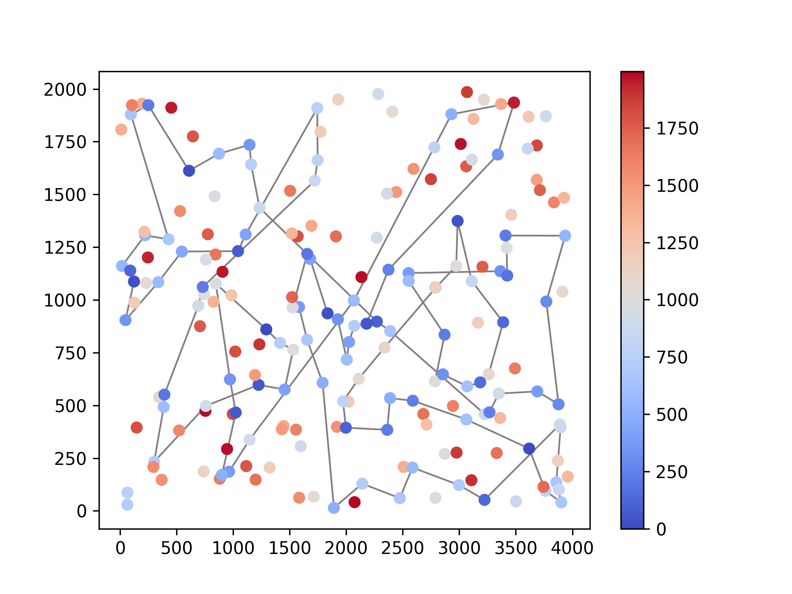

### Steepest, nodes, greedy

[38, 91, 157, 71, 4, 76, 132, 180, 28, 102, 185, 35, 51, 16, 67, 144, 140, 53, 179, 52, 177, 36, 131, 33, 9, 54, 8, 142, 164, 186, 136, 163, 29, 101, 178, 1, 169, 3, 50, 93, 47, 130, 159, 146, 170, 75, 153, 193, 78, 88, 107, 64, 57, 182, 138, 151, 42, 89, 113, 106, 150, 174, 176, 72, 134, 84, 58, 158, 192, 181, 114, 135, 73, 45, 87, 141, 189, 2, 171, 187, 30, 161, 127, 97, 160, 83, 123, 100, 152, 108, 49, 11, 168, 63, 149, 116, 60, 31, 48, 80]


### Steepest, edges, random

[3, 1, 59, 169, 50, 47, 147, 101, 55, 29, 178, 136, 186, 164, 8, 174, 9, 54, 33, 36, 177, 52, 67, 144, 185, 35, 16, 51, 132, 76, 4, 157, 71, 91, 80, 152, 108, 60, 149, 63, 116, 168, 49, 160, 123, 90, 180, 28, 102, 87, 141, 187, 30, 161, 127, 97, 69, 129, 104, 92, 171, 2, 189, 98, 114, 181, 135, 73, 45, 140, 179, 53, 99, 131, 84, 58, 192, 158, 134, 176, 150, 151, 182, 57, 64, 88, 78, 153, 193, 170, 159, 146, 107, 130, 113, 89, 42, 106, 93, 85]

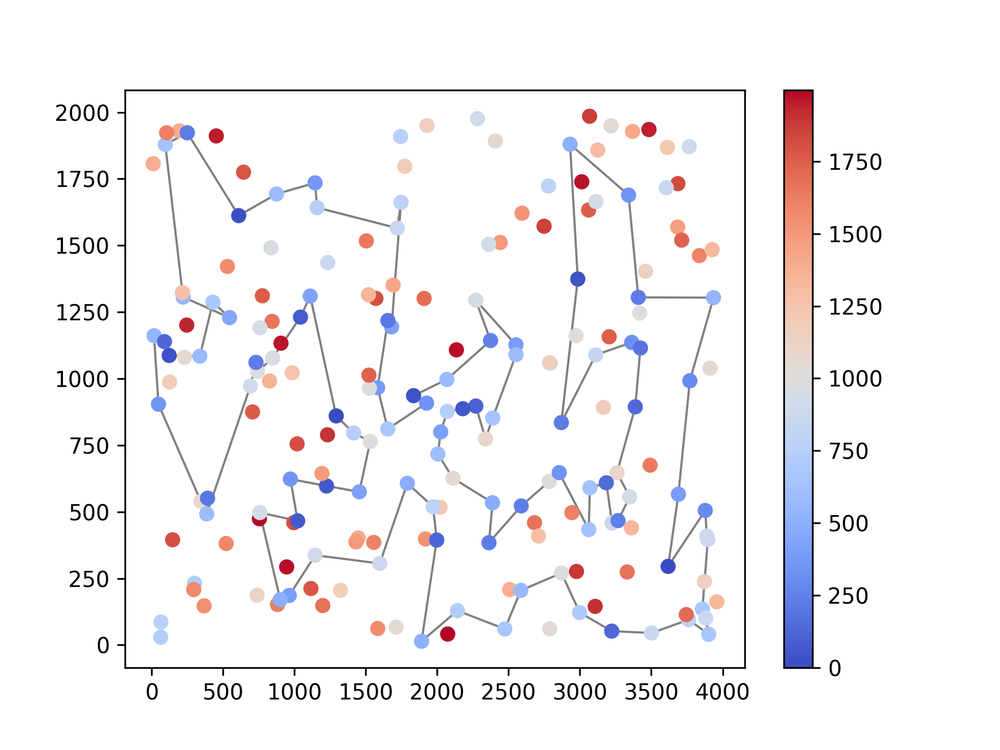

### Steepest, edges, greedy

[80, 48, 31, 60, 116, 149, 63, 168, 11, 49, 108, 152, 100, 123, 83, 160, 97, 127, 161, 30, 187, 171, 2, 189, 141, 87, 45, 73, 135, 114, 181, 192, 158, 58, 84, 134, 72, 176, 174, 150, 106, 113, 89, 42, 151, 138, 182, 57, 64, 107, 88, 78, 193, 153, 75, 170, 146, 159, 130, 47, 93, 50, 3, 169, 1, 178, 101, 29, 163, 136, 186, 164, 142, 8, 9, 54, 33, 131, 36, 177, 52, 179, 53, 140, 144, 67, 16, 51, 35, 185, 102, 28, 180, 132, 76, 4, 71, 157, 91, 38]


### Greedy, nodes, random

[164, 178, 136, 186, 39, 115, 5, 112, 139, 51, 16, 156, 180, 97, 127, 69, 129, 104, 171, 2, 187, 185, 35, 4, 76, 100, 123, 152, 108, 49, 168, 63, 149, 116, 60, 31, 48, 80, 91, 157, 71, 52, 33, 8, 142, 85, 29, 101, 1, 3, 50, 93, 130, 159, 153, 78, 88, 107, 89, 42, 106, 150, 151, 57, 182, 158, 192, 58, 67, 132, 90, 160, 30, 141, 28, 102, 87, 189, 98, 45, 73, 135, 114, 181, 41, 140, 53, 144, 179, 174, 176, 72, 134, 84, 99, 177, 36, 131, 54, 9]

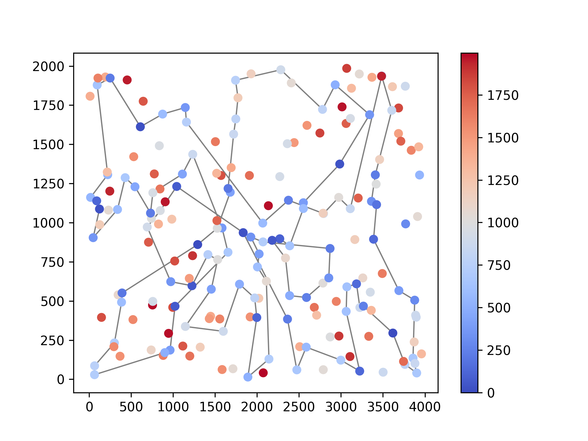

### Greedy, nodes, greedy

[60, 116, 149, 63, 168, 11, 49, 108, 152, 100, 123, 83, 160, 97, 127, 161, 30, 187, 171, 2, 189, 141, 87, 45, 73, 135, 114, 181, 192, 158, 58, 84, 134, 72, 176, 174, 150, 106, 113, 89, 42, 151, 138, 182, 57, 64, 107, 88, 78, 193, 153, 75, 170, 146, 159, 130, 47, 93, 50, 3, 169, 1, 178, 101, 55, 29, 163, 136, 186, 164, 142, 8, 54, 9, 33, 131, 36, 177, 52, 179, 53, 140, 144, 67, 16, 51, 35, 185, 102, 28, 180, 132, 76, 4, 71, 157, 91, 80, 48, 31]

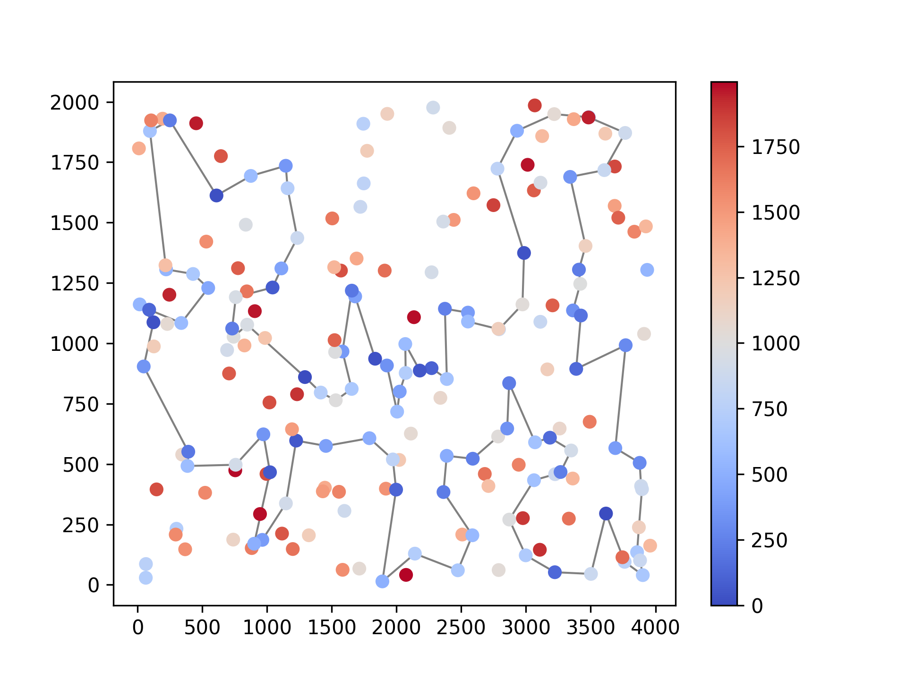

### Greedy, edges, random

[85, 142, 164, 186, 136, 29, 178, 1, 169, 3, 93, 50, 47, 130, 159, 170, 146, 107, 153, 193, 78, 88, 64, 57, 182, 42, 89, 113, 106, 150, 151, 72, 176, 134, 158, 192, 58, 84, 53, 140, 45, 73, 135, 114, 98, 87, 141, 187, 30, 189, 2, 171, 92, 69, 97, 127, 168, 116, 63, 149, 49, 60, 108, 152, 160, 83, 123, 90, 100, 38, 80, 31, 48, 91, 157, 71, 4, 76, 132, 180, 28, 156, 35, 51, 16, 185, 67, 52, 144, 179, 177, 131, 36, 143, 62, 33, 9, 54, 8, 174]

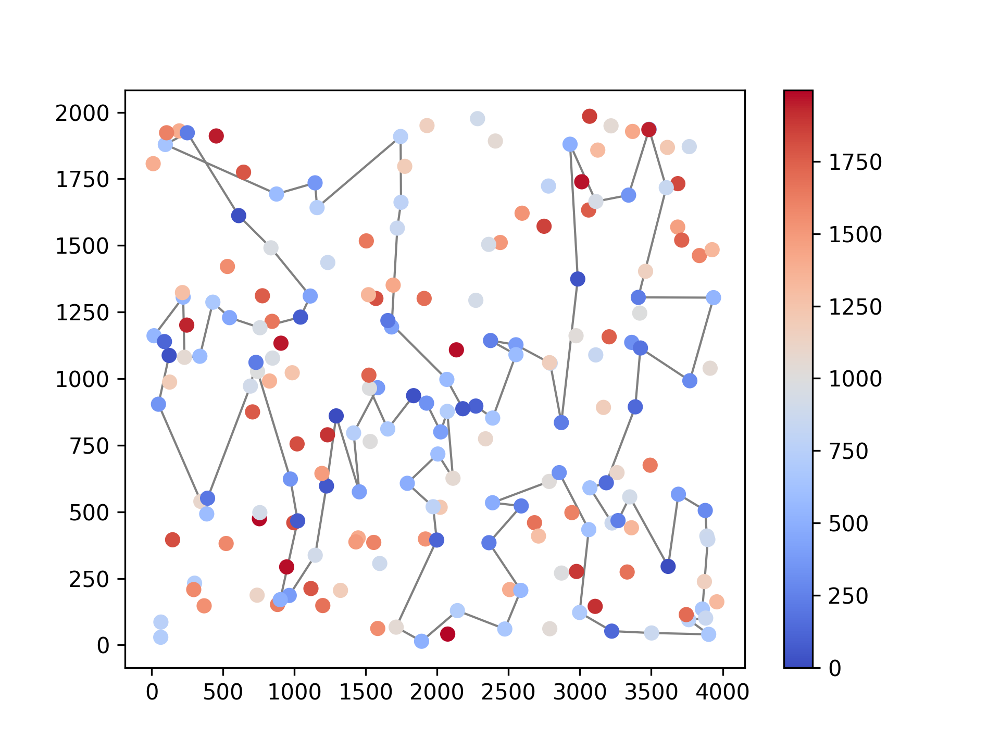

### Greedy, edges, greedy

[60, 116, 149, 63, 168, 11, 49, 108, 152, 100, 123, 83, 160, 97, 127, 161, 30, 187, 171, 2, 189, 141, 87, 45, 73, 135, 114, 181, 192, 158, 58, 84, 134, 72, 176, 174, 150, 106, 113, 89, 42, 151, 138, 182, 57, 64, 107, 88, 78, 193, 153, 75, 170, 146, 159, 130, 47, 93, 50, 3, 169, 1, 178, 101, 55, 29, 163, 136, 186, 164, 142, 8, 9, 54, 33, 131, 36, 177, 52, 179, 53, 140, 144, 67, 16, 51, 35, 185, 102, 28, 180, 132, 76, 4, 71, 157, 91, 80, 48, 31]


## Instance B

### Steepest, nodes, random

[140, 97, 115, 170, 125, 154, 191, 130, 50, 42, 147, 116, 149, 28, 65, 178, 132, 29, 197, 6, 155, 71, 40, 59, 73, 34, 67, 80, 153, 14, 20, 171, 99, 66, 76, 185, 81, 1 05, 94, 190, 194, 70, 187, 104, 144, 54, 196, 114, 10, 90, 129, 127, 192, 162, 11, 24, 179, 87, 82, 51, 85, 33, 64, 38, 21, 176, 30, 183, 8, 117, 46, 184, 3, 152, 181, 167, 45, 134, 175, 1 57, 60, 151, 122, 69, 160, 72, 86, 57, 89, 156, 48, 96, 198, 121, 120, 133, 136, 172, 189, 47]

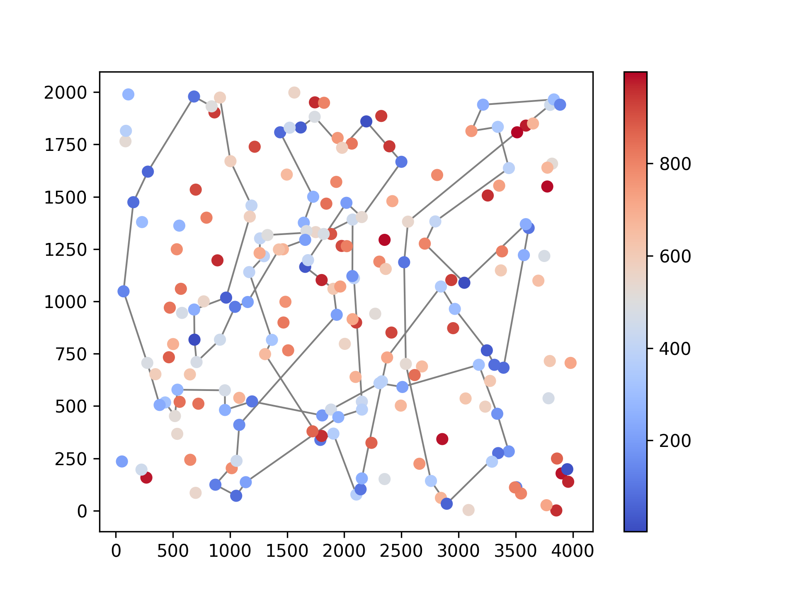

### Steepest, nodes, greedy

[65, 145, 28, 149, 13, 146, 37, 116, 147, 42, 50, 191, 130, 121, 198, 96, 48, 156, 89, 57, 185, 76, 162, 54, 192, 80, 127, 129, 90, 153, 14, 2, 20, 74, 17, 171, 99, 8 8, 179, 87, 82, 51, 85, 59, 73, 167, 181, 152, 34, 24, 67, 66, 27, 98, 151, 122, 3, 184, 46, 72, 117, 8, 120, 133, 136, 172, 160, 69, 189, 21, 183, 30, 38, 154, 140, 47, 64, 33, 40, 141, 1 55, 71, 60, 157, 45, 134, 175, 62, 36, 197, 6, 115, 170, 125, 177, 178, 29, 132, 174, 1]

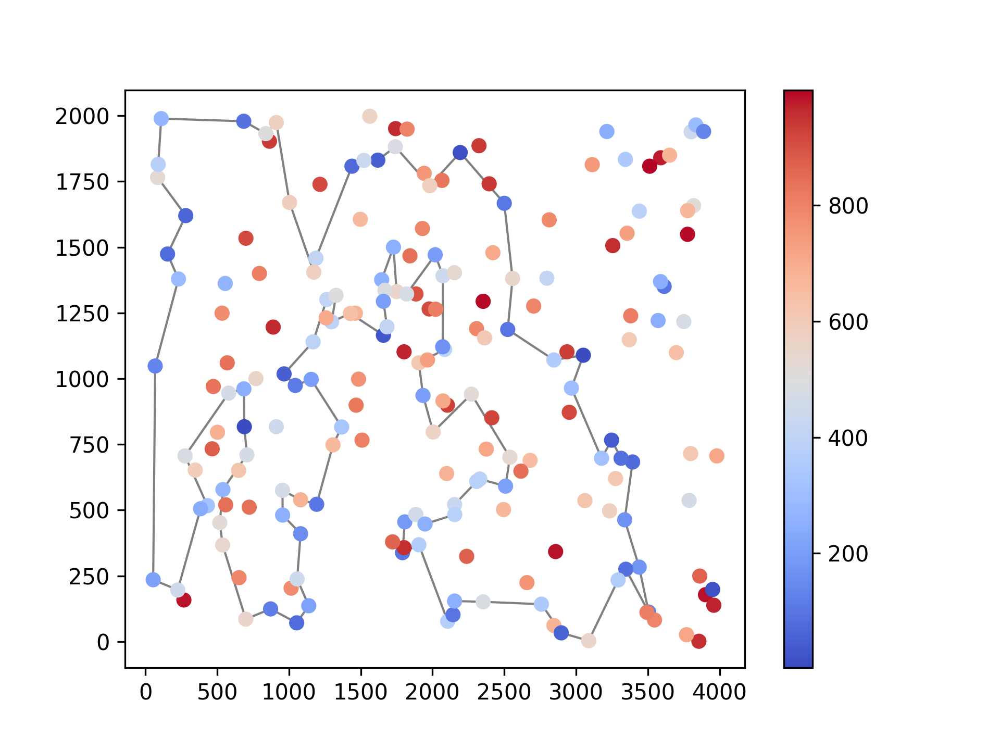

### Steepest, edges, random

[136, 172, 160, 69, 183, 21, 38, 30, 191, 130, 147, 42, 116, 149, 28, 145, 158, 177, 125, 170, 115, 6, 29, 132, 175, 134, 45, 157, 60, 40, 71, 155, 97, 154, 140, 47, 64, 85, 51, 59, 73, 167, 82, 87, 179, 181, 152, 24, 34, 67, 31, 66, 192, 162, 54, 127, 129, 90, 153, 74, 20, 14, 2, 93, 110, 118, 56, 148, 10, 196, 114, 105, 94, 81, 169, 187, 70, 190, 104 , 76, 135, 27, 98, 111, 151, 122, 184, 3, 46, 72, 86, 57, 89, 156, 48, 198, 96, 121, 120, 133]

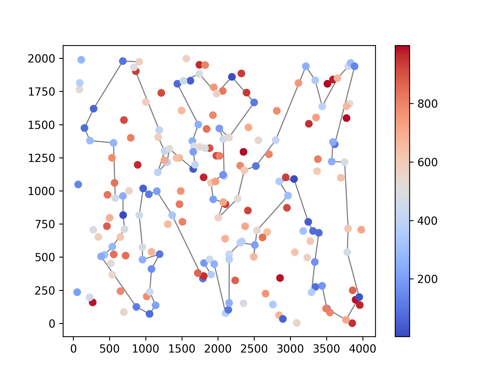

### Steepest, edges, greedy

[158, 26, 125, 177, 170, 115, 180, 6, 132, 29, 197, 36, 91, 62, 175, 134, 45, 157, 60, 71, 155, 40, 33, 64, 47, 140, 154, 38, 21, 69, 160, 172, 136, 133, 120, 8, 117, 72, 46, 184, 3, 122, 151, 98, 73, 59, 85, 51, 167, 87, 82, 179, 181, 24, 34, 67, 99, 39, 171, 17, 74, 20, 2, 14, 153, 90, 129, 127, 80, 192, 162, 54, 78, 10, 148, 114, 196, 61, 105, 94, 8 1, 70, 190, 57, 89, 48, 58, 96, 198, 121, 42, 147, 116, 37, 146, 13, 149, 28, 145, 65]

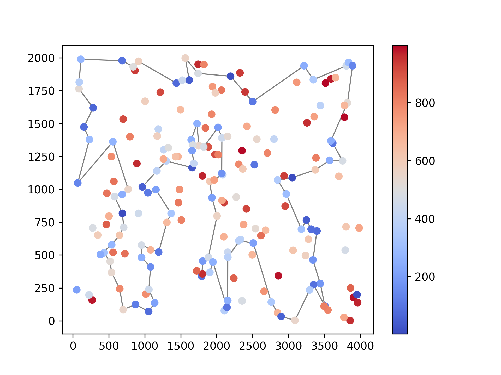

### Greedy, nodes, random

[184, 117, 8, 4, 64, 124, 172, 136, 133, 120, 72, 46, 86, 76, 54, 127, 80, 52, 129, 90, 10, 114, 196, 187, 70, 190, 104, 57, 89, 96, 198, 121, 183, 30, 176, 38, 21, 1 89, 168, 160, 69, 47, 140, 26, 125, 177, 158, 145, 28, 149, 116, 147, 50, 130, 191, 154, 97, 155, 60, 71, 197, 132, 29, 6, 170, 115, 141, 40, 157, 142, 175, 134, 45, 82, 87, 179, 181, 25, 27, 11, 24, 34, 99, 171, 74, 20, 14, 153, 182, 150, 67, 152, 167, 51, 85, 59, 73, 151, 122, 3]

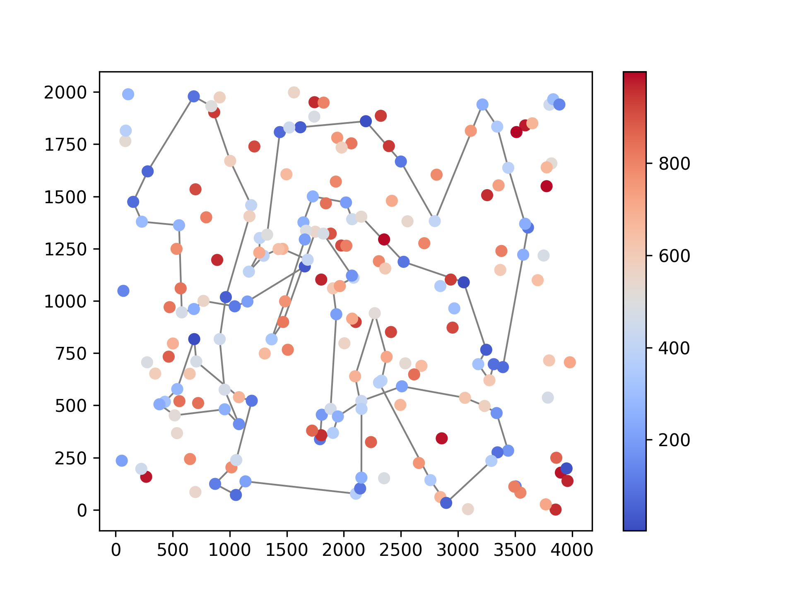

### Greedy, nodes, greedy

[65, 145, 28, 149, 13, 146, 37, 116, 147, 42, 50, 191, 130, 121, 198, 96, 48, 156, 89, 57, 185, 76, 162, 54, 192, 80, 127, 129, 90, 153, 14, 2, 20, 74, 17, 171, 99, 8 8, 179, 87, 82, 51, 85, 59, 73, 167, 181, 152, 34, 24, 67, 66, 27, 98, 151, 122, 3, 184, 46, 72, 117, 8, 120, 133, 136, 172, 160, 69, 189, 21, 183, 30, 38, 154, 140, 47, 64, 33, 40, 141, 1 55, 71, 60, 157, 45, 134, 175, 62, 36, 197, 6, 115, 170, 125, 177, 178, 29, 132, 174, 1]


### Greedy, edges, random

[178, 29, 132, 36, 197, 6, 180, 115, 170, 177, 125, 26, 154, 97, 141, 155, 71, 175, 134, 45, 142, 157, 60, 40, 33, 140, 47, 64, 73, 59, 85, 51, 167, 181, 152, 34, 24, 66, 67, 179, 82, 87, 99, 39, 171, 17, 2, 14, 20, 74, 182, 153, 80, 127, 129, 90, 10, 114, 196, 94, 105, 81, 70, 190, 187, 54, 192, 162, 76, 185, 57, 72, 46, 184, 3, 111, 98, 151, 69, 160, 172, 136, 133, 8, 117, 120, 96, 121, 130, 191, 30, 183, 21, 176, 38, 158, 145, 149, 28, 65]

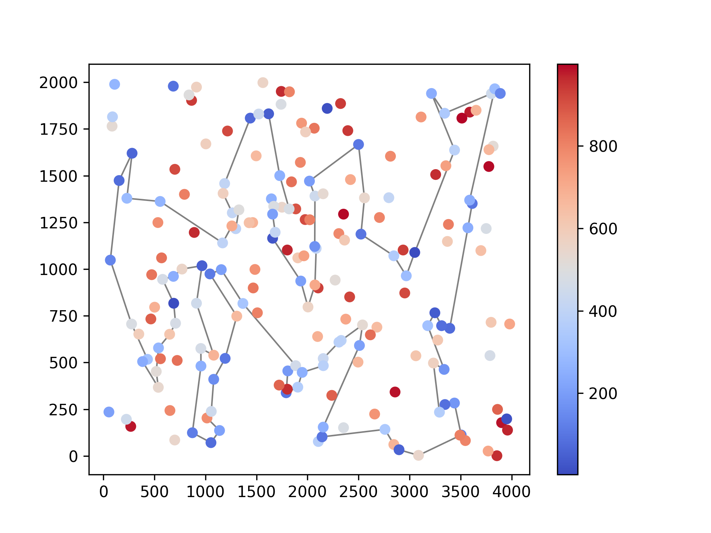

### Greedy, edges, greedy

[105, 94, 81, 70, 190, 57, 89, 156, 48, 96, 198, 121, 42, 147, 116, 37, 146, 13, 149, 28, 145, 158, 138, 177, 125, 26, 170, 115, 180, 6, 132, 29, 197, 36, 91, 62, 175 , 134, 45, 157, 60, 71, 155, 40, 33, 64, 47, 140, 154, 38, 30, 21, 69, 160, 172, 136, 133, 8, 120, 72, 46, 184, 3, 122, 151, 98, 73, 59, 85, 51, 167, 87, 82, 179, 181, 24, 34, 67, 99, 39, 171, 17, 74, 20, 2, 14, 153, 90, 129, 127, 80, 192, 162, 54, 78, 10, 148, 114, 196, 61]

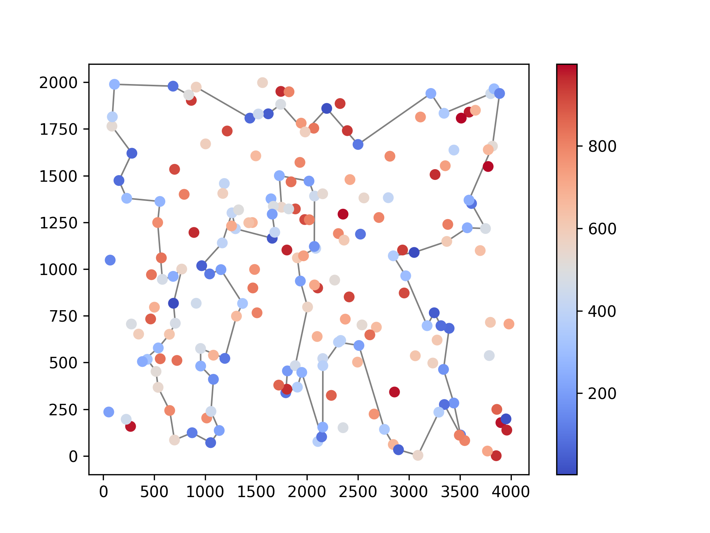

## Conclusions

Local search starting from already good solutions found by greedy methods improves on those solutions.

*All solutions have been verified with the solution checker*

## Source code

[https://github.com/WikiDrabinka/ce/tree/main/cpp/3](https://github.com/WikiDrabinka/ce/tree/main/cpp/3)
