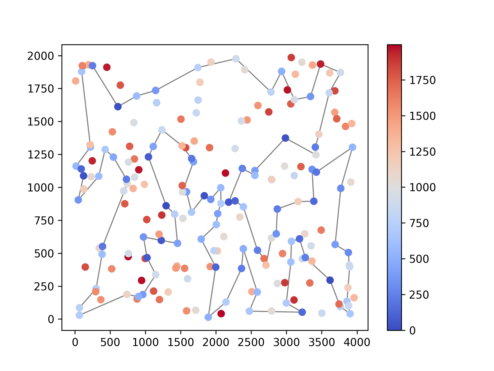
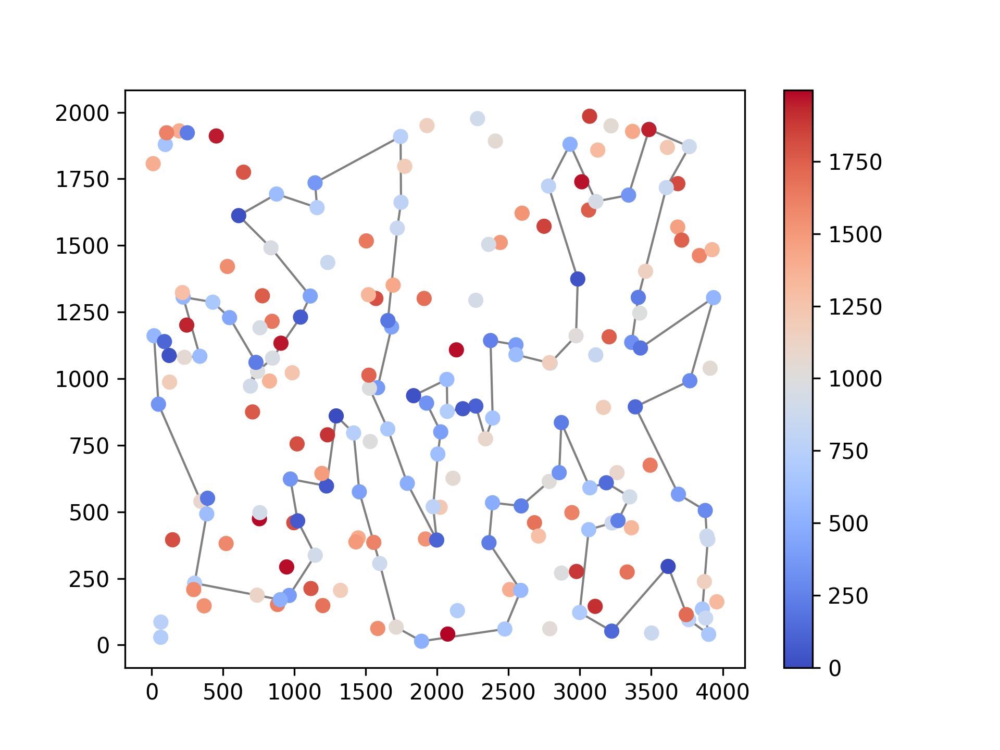
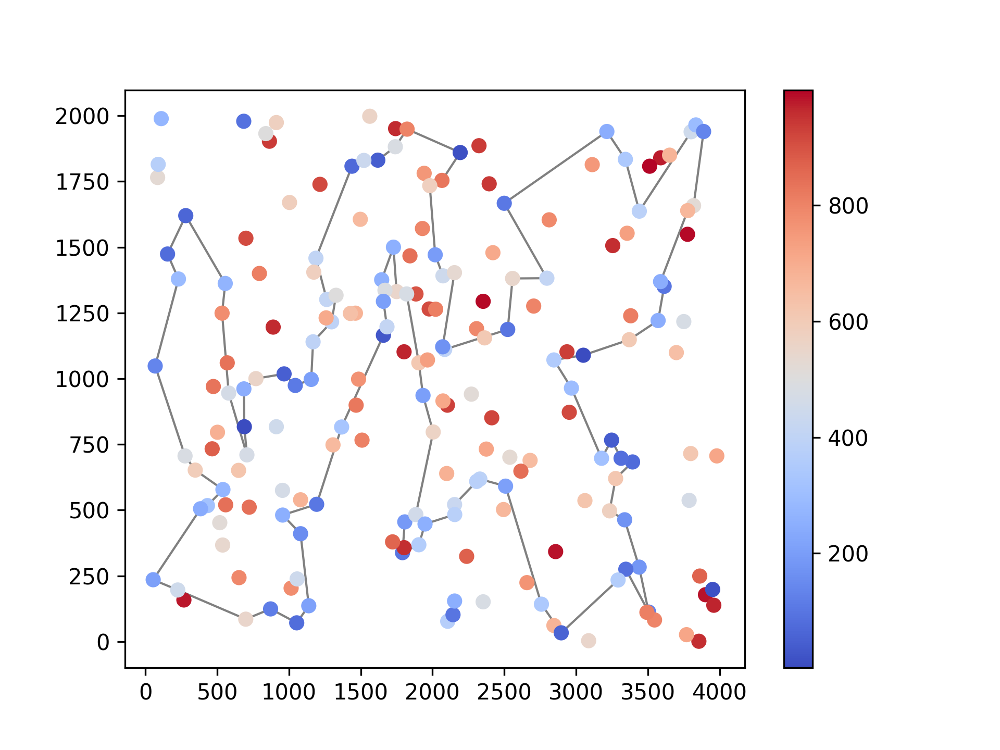
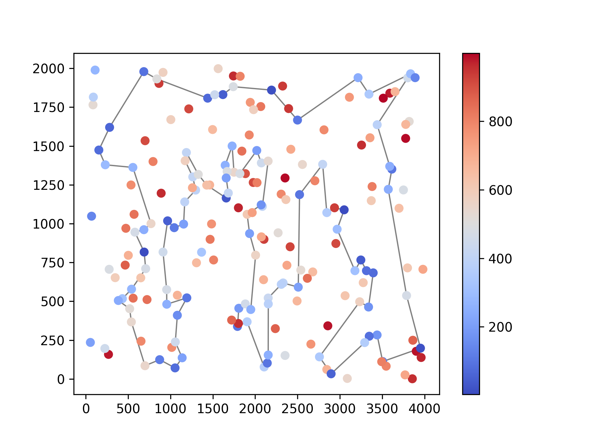

# Lab 4 Report

Wiktoria Drabińska 160294, Wojciech Dudziński 160293

## Problem description

We are given three columns of integers with a row for each node. The first two columns contain x
and y coordinates of the node positions in a plane. The third column contains node costs. The goal is
to select exactly 50% of the nodes (if the number of nodes is odd we round the number of nodes to
be selected up) and form a Hamiltonian cycle (closed path) through this set of nodes such that the
sum of the total length of the path plus the total cost of the selected nodes is minimized.

The distances between nodes are calculated as Euclidean distances rounded mathematically to
integer values. The distance matrix should be calculated just after reading an instance and then only
the distance matrix (no nodes coordinates) should be accessed by optimization methods to allow
instances defined only by distance matrices.

## Algorithm

TO DO

## Results

| Method / Run type | Instance A: average (min - max) | Instance B: average (min - max) |
| --- | --- | --- |
| Steepest Local Search | 76204.2 (**73385** - 79382) | **52568.6** (50007 - **55514**) |
| Candidate Edges Local Search (k=10) | 80503.8 (76756 - 85005) | 52825.5 (50836 - 55595) |
| Candidate Edges Local Search (k=5) | 87451.8 (80889 - 94316) | 54871.1 (52224 - 58597) |
| Candidate Edges Local Search (k=20) | 76669.5 (74138 - 80143) | 52581 (50542 - 55429) |
| Candidate Edges Local Search (k=25) | 76312.9 (73651 - 80333) | 52677.8 (**49643** - 56301) |
| Candidate Edges Local Search (k=30) | 76155.3 (73914 - 80190) | 52593 (50584 - 55743) |
| Candidate Edges Local Search (k=35) | **76087.9** (73941 - **79708**) | 52674.6 (50448 - 56782) |
| Candidate Edges Local Search (k=50) | 76136.5 (73905 - 79766) | 52637.7 (50451 - **55514**) |
| Candidate Edges Local Search (k=100) | 76219.4 (**73385** - 79382) | 52573.6 (50007 - **55514**) |

## Runtimes

| Method / Run type | Instance A: average (min - max) | Instance B: average (min - max) |
| --- | --- | --- |
| Steepest Local Search | 10.332 ms (8.4489 ms - 31.7796 ms) | 9.92681 ms (8.4009 ms - 13.582 ms) |
| Candidate Edges Local Search (k=10) | 1.25559 ms (0.9893 ms - 2.9987 ms) | 1.43801 ms (1.1152 ms - 2.5733 ms) |
| Candidate Edges Local Search (k=5) | **0.64507 ms (0.5092 ms - 2.3669 ms)** | **0.709345 ms (0.564 ms - 1.3079 ms)** |
| Candidate Edges Local Search (k=20) | 2.66259 ms (2.187 ms - 2.66259 ms) | 2.97213 ms (2.3657 ms - 5.0879 ms) |
| Candidate Edges Local Search (k=25) | 3.41336 ms (2.6931 ms - 5.0966 ms) | 3.7708 ms (3.0268 ms - 6.2143 ms) |
| Candidate Edges Local Search (k=30) | 4.23097 ms (3.3808 ms - 5.9489 ms) | 4.67138 ms (3.6877 ms - 8.0022 ms) |
| Candidate Edges Local Search (k=35) | 5.02493 ms (4.1666 ms - 8.0787 ms) | 5.6205 ms (4.5343 ms - 10.3583 ms) |
| Candidate Edges Local Search (k=50) | 11.3715 ms (8.5641 ms - 22.7999 ms) | 9.78243 ms (6.9853 ms - 20.049 ms) |
| Candidate Edges Local Search (k=100) | 26.7305 ms (15.5363 ms - 183.749 ms) | 33.5197 ms (17.7141 ms - 336.716 ms) |

## Instance A

### Best solution (k=10)

```[152, 123, 83, 97, 127, 69, 129, 104, 92, 171, 2, 189, 187, 30, 141, 87, 28, 180, 132, 76, 4, 196, 51, 16, 156, 35, 185, 67, 144, 52, 179, 53, 140, 45, 135, 114, 181, 58, 84, 158, 192, 57, 182, 151, 150, 106, 89, 107, 88, 78, 193, 153, 170, 146, 159, 130, 47, 147, 50, 3, 93, 81, 174, 176, 72, 65, 13, 134, 131, 36, 177, 33, 54, 9, 164, 169, 1, 59, 101, 55, 29, 178, 184, 136, 186, 39, 115, 157, 91, 80, 48, 7, 31, 60, 116, 149, 63, 168, 49, 108]```



### Best solution (all ks)

```[177, 179, 52, 67, 144, 53, 140, 73, 135, 45, 185, 156, 35, 16, 51, 139, 112, 115, 157, 71, 91, 80, 38, 76, 132, 90, 83, 160, 123, 152, 108, 60, 49, 11, 63, 149, 116, 168, 95, 97, 127, 69, 171, 2, 189, 187, 30, 141, 180, 28, 87, 98, 25, 114, 192, 158, 58, 84, 134, 176, 174, 150, 106, 113, 89, 42, 151, 182, 57, 107, 88, 78, 193, 153, 170, 146, 159, 130, 93, 47, 147, 50, 3, 1, 101, 55, 29, 178, 184, 136, 186, 164, 142, 8, 54, 9, 33, 131, 99, 36]```




## Instance B

### Best solution (k=10)

```[122, 151, 98, 73, 59, 85, 51, 167, 181, 152, 34, 24, 67, 99, 171, 74, 20, 2, 14, 153, 182, 52, 90, 129, 127, 80, 192, 162, 54, 78, 10, 114, 196, 139, 61, 105, 94, 81, 187, 70, 190, 57, 104, 185, 76, 3, 184, 86, 46, 72, 156, 32, 89, 164, 48, 96, 198, 121, 130, 30, 183, 21, 38, 47, 140, 154, 26, 125, 170, 115, 177, 138, 158, 149, 28, 145, 65, 178, 103, 6, 29, 132, 1, 174, 62, 175, 134, 45, 60, 71, 40, 64, 69, 160, 172, 136, 133, 120, 8, 117]```



### Best solution (all ks)

```[157, 60, 40, 71, 155, 97, 154, 140, 47, 38, 21, 30, 191, 130, 183, 189, 69, 160, 172, 136, 133, 120, 8, 117, 72, 46, 86, 3, 184, 122, 151, 98, 167, 73, 59, 85, 51, 82, 87, 179, 181, 152, 34, 24, 67, 76, 104, 162, 159, 54, 192, 80, 127, 129, 90, 153, 182, 99, 171, 74, 20, 14, 2, 110, 118, 10, 114, 196, 187, 81, 105, 94, 70, 190, 57, 89, 48, 96, 198, 121, 147, 116, 149, 28, 145, 158, 26, 125, 177, 170, 115, 6, 29, 132, 197, 36, 62, 175, 134, 45]```



## Conclusions


*All solutions have been verified with the solution checker*

## Source code

[https://github.com/WikiDrabinka/ce/tree/main/cpp/4](https://github.com/WikiDrabinka/ce/tree/main/cpp/4)
