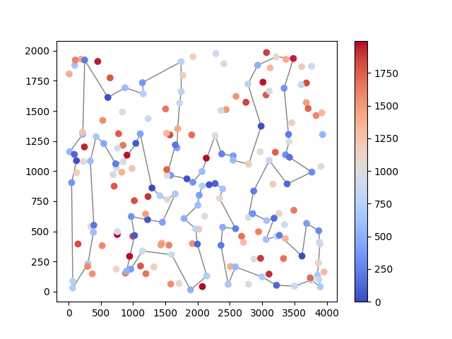
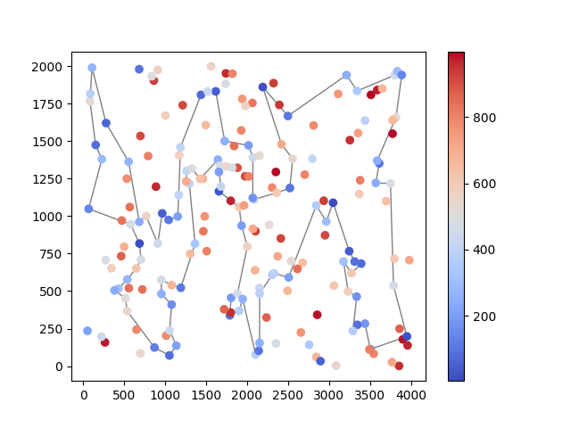

# Lab 5 Report

Wiktoria Drabińska 160294, Wojciech Dudziński 160293

## Problem description

We are given three columns of integers with a row for each node. The first two columns contain x
and y coordinates of the node positions in a plane. The third column contains node costs. The goal is
to select exactly 50% of the nodes (if the number of nodes is odd we round the number of nodes to
be selected up) and form a Hamiltonian cycle (closed path) through this set of nodes such that the
sum of the total length of the path plus the total cost of the selected nodes is minimized.

The distances between nodes are calculated as Euclidean distances rounded mathematically to
integer values. The distance matrix should be calculated just after reading an instance and then only
the distance matrix (no nodes coordinates) should be accessed by optimization methods to allow
instances defined only by distance matrices.

## Algorithm

### Local search using move evaluations (deltas) from previous iterations

```
Algorithm: EvaluateAllMovesInto(LM, matrix, costs, solution, m, n, is_selected)

    Clear(LM)
    Fill(is_selected, False)

    // Mark all currently selected nodes
    For each node in solution do
        is_selected[node] <- True
    End For

    // 1. Generate intra-route 2-opt moves
    For i <- 0 to m - 1 do
        For j <- i + 1 to m - 1 do

            // Skip adjacent edges
            If j == (i + 1) mod m OR i == (j + 1) mod m then
                Continue
            End If

            u1 <- solution[i]
            u2 <- solution[(i + 1) mod m]
            v1 <- solution[j]
            v2 <- solution[(j + 1) mod m]

            old_cost <- matrix[u1][u2] + matrix[v1][v2]
            new_cost <- matrix[u1][v1] + matrix[u2][v2]

            delta <- new_cost - old_cost

            // Store only improving moves
            If delta < -EPS then
                LM.Push(
                    (0, delta, u1, u2, v1, v2, -1)
                )
            End If
        End For
    End For

    // 2. Generate inter-route node exchange moves
    For i <- 0 to m - 1 do

        w <- solution[i]
        pred <- solution[(i - 1 + m) mod m]
        succ <- solution[(i + 1) mod m]

        For v <- 0 to n - 1 do

            // Skip nodes already present in the solution
            If is_selected[v] then
                Continue
            End If

            old_cost <- costs[w]
                        + matrix[pred][w]
                        + matrix[w][succ]

            new_cost <- costs[v]
                        + matrix[pred][v]
                        + matrix[v][succ]

            delta <- new_cost - old_cost

            // Store only improving moves
            If delta < -EPS then
                LM.Push(
                    (1, delta, pred, w, w, succ, v)
                )
            End If
        End For
    End For

    // Sort moves by increasing delta
    Sort(LM)

    Return LM
```

```
Algorithm: LMSteepestLocalSearch(matrix, costs, initial_solution, m)
    solution <- Copy(initial_solution)
    n <- Size(matrix)

    succ <- Array(n, -1)
    pos_in_sol <- Array(n, -1)
    is_selected <- Array(n, False)

    LM <- Empty List

    // Generate and sort all improving moves
    EvaluateAllMovesInto(LM, matrix, costs, solution, m, n, is_selected)

    While LM is not empty do

        Fill(succ, -1)
        Fill(pos_in_sol, -1)

        // Build successor and position arrays
        For i <- 0 to m - 1 do
            succ[solution[i]] <- solution[(i + 1) mod m]
            pos_in_sol[solution[i]] <- i
        End For

        applied <- False
        write_idx <- 0

        // Process moves in sorted order
        For read_idx <- 0 to Size(LM) - 1 do
            mv <- LM[read_idx]

            If applied then
                LM[write_idx] <- mv
                write_idx <- write_idx + 1
                Continue
            End If

            If mv.type == 0 then
                // 2-opt move: check whether removed edges still exist

                e1_fwd <- (succ[mv.u1] == mv.u2)
                e1_rev <- (succ[mv.u2] == mv.u1)

                e2_fwd <- (succ[mv.v1] == mv.v2)
                e2_rev <- (succ[mv.v2] == mv.v1)

                // Rule 1: At least one removed edge no longer exists
                If NOT e1_fwd AND NOT e1_rev then
                    Continue
                End If

                If NOT e2_fwd AND NOT e2_rev then
                    Continue
                End If

                // Rule 3: Both edges have the same orientation
                If (e1_fwd AND e2_fwd) OR (e1_rev AND e2_rev) then
                    ApplyMove(solution, mv, pos_in_sol, m)
                    applied <- True
                    Continue
                End If

                // Rule 2: Edges have inverted orientation
                // Defer the move for later consideration
                LM[write_idx] <- mv
                write_idx <- write_idx + 1

            Else
                // Node exchange move: check whether the move is still valid

                w <- mv.u2
                pred <- mv.u1
                s_node <- mv.v2

                e1_fwd <- (succ[pred] == w)
                e1_rev <- (succ[w] == pred)

                e2_fwd <- (succ[w] == s_node)
                e2_rev <- (succ[s_node] == w)

                // Rule 1: The removed node is no longer selected,
                // the inserted node is already selected,
                // or at least one required edge no longer exists
                If pos_in_sol[w] == -1 OR pos_in_sol[mv.v_in] != -1 then
                    Continue
                End If

                If NOT e1_fwd AND NOT e1_rev then
                    Continue
                End If

                If NOT e2_fwd AND NOT e2_rev then
                    Continue
                End If

                // Rule 3: Both edges have the same orientation
                If (e1_fwd AND e2_fwd) OR (e1_rev AND e2_rev) then
                    ApplyMove(solution, mv, pos_in_sol, m)
                    applied <- True
                    Continue
                End If

                // Rule 2: Edges have inverted orientation
                // Defer the move for later consideration
                LM[write_idx] <- mv
                write_idx <- write_idx + 1
            End If
        End For

        // Remove discarded moves
        Resize(LM, write_idx)

        // If no move was applied, regenerate the entire neighborhood
        If NOT applied then
            EvaluateAllMovesInto(
                LM, matrix, costs, solution, m, n, is_selected
            )

            If LM is empty then
                Break
            End If
        End If
    End While

    Return solution
```

## Results

| Method / Run type | Instance A: average (min - max) | Instance B: average (min - max) |
| --- | --- | --- |
| Steepest Local Search | **76204.2** (**73385** - **79382**) | **52568.6** (**50007** - **55514**) |
| Steepest Local Search with LM | 76325.8 (74018 - 79843) | 52997.4 (50759 - 56839) |

## Runtimes

| Method / Run type | Instance A: average (min - max) | Instance B: average (min - max) |
| --- | --- | --- |
| Steepest Local Search | 10.332 ms (8.4489 ms - 31.7796 ms) | 9.92681 ms (8.4009 ms - 13.582 ms) |
| Steepest Local Search with LM  | **2.84608 ms (2.3576 ms - 4.8122 ms)** | **2.84705 ms (2.2333 ms - 4.1523 ms)** |

## Instance A

```[134, 84, 58, 192, 158, 182, 57, 64, 88, 78, 193, 153, 170, 146, 159, 130, 107, 89, 42, 151, 106, 150, 176, 72, 174, 85, 93, 47, 50, 3, 169, 1, 178, 29, 163, 136, 186, 164, 8, 54, 9, 33, 143, 52, 144, 67, 35, 156, 51, 16, 133, 139, 112, 115, 157, 71, 91, 80, 48, 60, 116, 149, 63, 168, 129, 104, 69, 127, 97, 49, 108, 152, 123, 90, 132, 76, 180, 28, 102, 185, 87, 141, 30, 187, 171, 2, 189, 98, 114, 181, 135, 73, 45, 140, 53, 179, 177, 36, 131, 99]```




## Instance B

```[149, 158, 125, 26, 97, 154, 140, 47, 38, 130, 121, 198, 96, 120, 72, 46, 184, 3, 135, 76, 185, 79, 89, 57, 190, 70, 81, 94, 105, 61, 196, 114, 10, 148, 118, 110, 2, 14, 20, 74, 153, 182, 80, 52, 90, 129, 127, 54, 192, 162, 67, 24, 34, 181, 179, 87, 82, 167, 51, 85, 59, 73, 98, 151, 122, 69, 160, 172, 136, 133, 189, 183, 30, 176, 21, 64, 40, 141, 155, 71, 60, 157, 45, 134, 175, 36, 197, 132, 29, 6, 180, 115, 170, 177, 65, 145, 28, 13, 146, 37]```



## Conclusions

1. The LM optimization significantly reduced execution time. The average runtime decreased by approximately 72% for both instances, making the optimized algorithm around 3.5 times faster than the standard Steepest Local Search. This confirms that reusing previously evaluated moves effectively reduces redundant neighborhood calculations.

2. Regular Steepest Local Search achieved slightly better results in both instances, but the results were very similar and the difference in performance was much smaller than ones observed in previous labs.

3. Both algorithms showed consistent performance across the tested instances. Their average execution times were similar for Instances A and B. The LM-based approach maintained an average runtime of approximately 2.85 ms, while the standard approach required approximately 10 ms. This indicates that the performance improvement is not specific to a particular instance.

4. Overall, the LM optimization provides a substantial improvement in computational efficiency at the cost of slightly worse solution quality. The average objective value increased by only 0.16% for Instance A and 0.82% for Instance B, while execution time decreased by more than 70%. Therefore, the LM-based approach is a good alternative when runtime is more important than obtaining the best possible solution.

*All solutions have been verified with the solution checker*

## Source code

[https://github.com/WikiDrabinka/ce/tree/main/cpp/5](https://github.com/WikiDrabinka/ce/tree/main/cpp/5)
