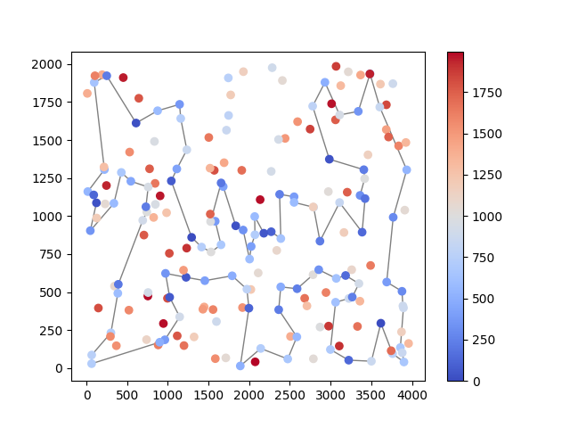
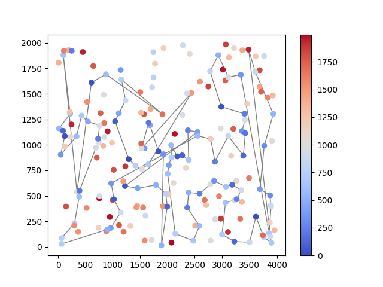
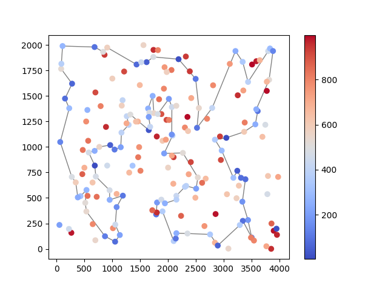

# Lab 6 Report

Wiktoria Drabińska 160294, Wojciech Dudziński 160293

## Problem description

We are given three columns of integers with a row for each node. The first two columns contain x
and y coordinates of the node positions in a plane. The third column contains node costs. The goal is
to select exactly 50% of the nodes (if the number of nodes is odd we round the number of nodes to
be selected up) and form a Hamiltonian cycle (closed path) through this set of nodes such that the
sum of the total length of the path plus the total cost of the selected nodes is minimized.

The distances between nodes are calculated as Euclidean distances rounded mathematically to
integer values. The distance matrix should be calculated just after reading an instance and then only
the distance matrix (no nodes coordinates) should be accessed by optimization methods to allow
instances defined only by distance matrices.

## Algorithms

### Multiple Start Local Search

```
Algorithm: RunMSLS(matrix, costs, n, m, iterations)

    best_solution <- Empty List
    best_cost <- INFINITY

    // Perform multiple independent random restarts
    For iter <- 0 to iterations - 1 do

        // Generate a random initial solution
        init_sol <- GenerateRandomSolution(n, m)

        // Optimize the initial solution using local search
        local_opt <- LMSteepestLocalSearch(
            matrix, costs, init_sol, m
        )

        // Evaluate the optimized solution
        cost <- Evaluate(matrix, costs, local_opt)

        // Update the global best solution
        If cost < best_cost then
            best_cost <- cost
            best_solution <- local_opt
        End If

    End For

    Return best_solution
```

### Perturbation

For the perturbation we used 3 random inter-route moves joined with 3 random intra-route moves.

```
Algorithm: Perturb(solution, n, m, k_intra, k_inter)

    perturbed <- Copy(solution)

    // 1. Intra-route perturbation: random 2-opt segment reversals
    For step <- 0 to k_intra - 1 do

        // Select two random positions
        i <- RandomInteger(0, m - 1)
        j <- RandomInteger(0, m - 1)

        // Skip identical or adjacent positions
        If i == j OR j == (i + 1) mod m OR i == (j + 1) mod m then
            Continue
        End If

        // Ensure i < j
        If i > j then
            Swap(i, j)
        End If

        // Reverse the segment between selected positions
        ReverseSegment(perturbed, (i + 1) mod m, j, m)

    End For

    // 2. Inter-route perturbation: exchange selected nodes
    // with randomly chosen unselected nodes

    is_selected <- Array(n, False)

    // Mark all currently selected nodes
    For each node in perturbed do
        is_selected[node] <- True
    End For

    unselected <- Empty List

    // Build the pool of unselected nodes
    For v <- 0 to n - 1 do
        If NOT is_selected[v] then
            unselected.Push(v)
        End If
    End For

    If unselected is not empty then

        // Randomize the order of unselected nodes
        Shuffle(unselected)

        // Determine the number of exchanges
        swaps <- Min(k_inter, m, Size(unselected))

        positions <- [0, 1, ..., m - 1]

        // Randomize positions in the solution
        Shuffle(positions)

        // Replace randomly selected nodes
        For s <- 0 to swaps - 1 do
            perturbed[positions[s]] <- unselected[s]
        End For

    End If

    Return perturbed
```

#### Example perturbation

Original | Perturbed
--- | ---
 | 

### Iterated Local Search

```
Algorithm: RunILS(matrix, costs, n, m, max_time_ms)

    start_time <- CurrentTimeMilliseconds()

    // 1. Generate and optimize the initial solution
    init_sol <- GenerateRandomSolution(n, m)

    current_x <- LMSteepestLocalSearch(
        matrix, costs, init_sol, m
    )

    current_cost <- Evaluate(matrix, costs, current_x)

    // Initialize the global best solution
    best_x <- Copy(current_x)
    best_cost <- current_cost

    // Count the number of local search executions
    ls_runs <- 1

    // Set perturbation strength
    k_intra <- 3
    k_inter <- 3

    // 2. Iterated Local Search loop
    While True do

        // Check elapsed execution time
        now <- CurrentTimeMilliseconds()
        elapsed_ms <- now - start_time

        If elapsed_ms >= max_time_ms then
            Break
        End If

        // 3. Perturb the current local optimum
        y <- Perturb(
            current_x, n, m, k_intra, k_inter
        )

        // 4. Apply local search to the perturbed solution
        y <- LMSteepestLocalSearch(
            matrix, costs, y, m
        )

        // Evaluate the new local optimum
        y_cost <- Evaluate(matrix, costs, y)

        ls_runs <- ls_runs + 1

        // 5. Acceptance criterion:
        // Accept only strictly better local optima
        If y_cost < current_cost - EPS then

            current_x <- y
            current_cost <- y_cost

            // Update the global best solution
            If current_cost < best_cost - EPS then
                best_cost <- current_cost
                best_x <- Copy(current_x)
            End If

        End If

    End While

    Return (best_x, ls_runs)
```

## Results

| Method / Run type | Instance A: average (min - max) | Instance B: average (min - max) |
| --- | --- | --- |
| Multiple Start Local Search | 73706.4 (73255 - 74137) | 50278.4 (49565 - 50767) |
| Iterated Local Search | **71651 (71484 - 72058)** | **48358 (48150 - 48672)** |
| *Previous labs* |
| Greedy Cycle Weighted Regret | 73339.4 (72011 - 76027) | 57902.1 (52860 - 63406)
| Nearest Neighbor Full Route Weighted Regret | 75542.5 (72419 - 78504) | 55694.2 (50485 - 61406) |
| LS: steepest, nodes, random | 89912.8 (82601 - 98560) | 65898.8 (58765 - 74064) |
| LS: steepest, nodes, greedy | 72997.2 (71994 - 75688) | 54288.8 (49978 - 61265) |
| LS: steepest, edges, random | 77422.7 (75020 - 80978) | 53573 (51443 - 56060) |
| LS: steepest, edges, greedy | 73023.3 (72009 - 75073) | 53220.6 (49676 - 60362) |

## Runtimes

| Method / Run type | Instance A: average (min - max) | Instance A: LS runs | Instance B: average (min - max) | Instance B: LS runs |
| --- | --- | --- | --- | --- |
| Multiple Start Local Search | 1088.82 ms (1061.69 ms - 1180.21 ms) | *400* | 1092.07 ms (1043.55 ms - 1246.88 ms) | *400* |
| Iterated Local Search | 1089.09 ms (1088.83 ms - 1089.67 ms)** | 2648.95 (2169 - 3035) | 1092.29 ms (1092.07 ms - 1092.76 ms) | 2433.3 (1210 - 5251) |

## Instance A

### Multiple Start Local Search

```[132, 76, 4, 71, 157, 112, 139, 51, 16, 35, 156, 180, 28, 185, 67, 144, 140, 53, 179, 52, 177, 36, 131, 33, 9, 54, 8, 174, 72, 176, 150, 151, 42, 89, 113, 43, 106, 85, 164, 186, 136, 163, 29, 101, 178, 1, 169, 3, 50, 93, 47, 130, 159, 146, 170, 153, 193, 78, 88, 107, 57, 182, 111, 192, 158, 134, 84, 58, 135, 73, 45, 87, 141, 189, 2, 171, 187, 30, 161, 97, 127, 69, 104, 129, 168, 116, 149, 63, 11, 49, 160, 123, 152, 108, 60, 82, 31, 48, 80, 91]```


### Iterated Local Search

```[132, 76, 4, 71, 157, 91, 80, 48, 31, 60, 116, 149, 63, 168, 49, 108, 152, 100, 123, 83, 160, 97, 127, 69, 129, 104, 171, 2, 189, 187, 30, 141, 87, 45, 73, 135, 114, 181, 192, 158, 58, 84, 134, 72, 176, 150, 106, 113, 89, 42, 151, 182, 57, 64, 107, 88, 78, 193, 153, 170, 146, 159, 130, 47, 147, 101, 29, 178, 184, 136, 186, 164, 1, 169, 3, 50, 93, 85, 174, 8, 54, 9, 33, 131, 36, 177, 52, 179, 53, 140, 144, 67, 16, 51, 156, 35, 185, 102, 28, 180]```


## Instance B

### Multiple Start Local Search

```[181, 179, 87, 82, 51, 85, 59, 73, 167, 98, 151, 3, 184, 46, 72, 117, 120, 133, 136, 172, 160, 69, 189, 183, 130, 191, 30, 176, 21, 38, 47, 140, 154, 97, 71, 40, 60, 157, 45, 134, 175, 36, 197, 29, 132, 103, 6, 115, 170, 177, 125, 26, 158, 145, 28, 149, 146, 37, 116, 147, 121, 198, 96, 89, 57, 185, 76, 162, 192, 54, 104, 190, 70, 94, 105, 81, 187, 196, 114, 10, 127, 80, 129, 90, 153, 118, 110, 93, 2, 14, 20, 74, 17, 171, 99, 31, 67, 24, 34, 152]```


### Iterated Local Search

```[37, 116, 147, 42, 121, 198, 96, 48, 89, 57, 185, 76, 104, 190, 70, 187, 81, 94, 105, 61, 196, 114, 10, 78, 54, 162, 192, 80, 127, 129, 90, 153, 14, 2, 20, 74, 17, 171, 99, 88, 179, 87, 82, 51, 85, 59, 73, 167, 181, 152, 34, 24, 67, 66, 27, 151, 3, 184, 46, 72, 117, 8, 120, 133, 136, 172, 160, 69, 183, 30, 21, 38, 47, 140, 154, 97, 155, 71, 40, 60, 157, 45, 134, 175, 36, 197, 132, 29, 6, 180, 115, 170, 125, 177, 158, 145, 28, 149, 13, 146]```



## Conclusions

TODO

*All solutions have been verified with the solution checker*

## Source code

[https://github.com/WikiDrabinka/ce/tree/main/cpp/6](https://github.com/WikiDrabinka/ce/tree/main/cpp/6)
