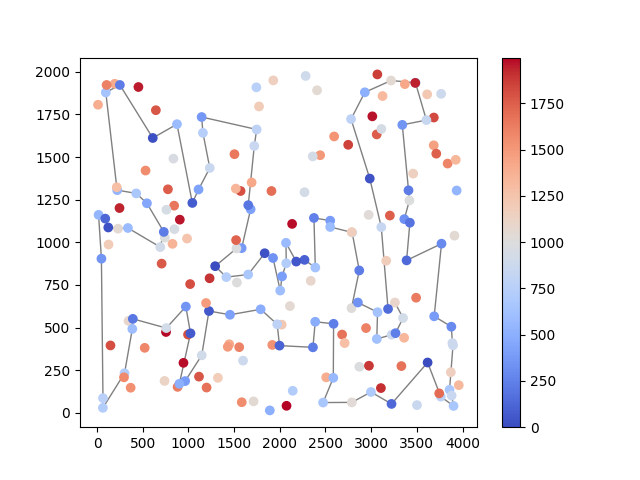
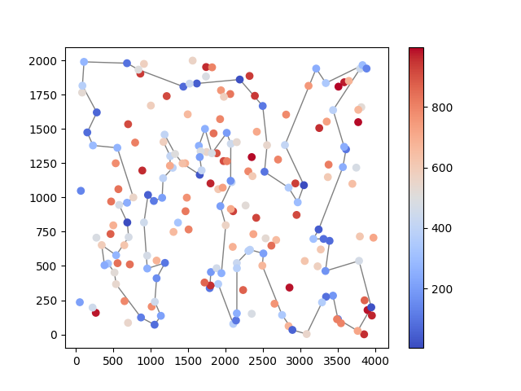

# Lab 6 Report

Wiktoria Drabińska 160294, Wojciech Dudziński 160293

## Problem description

We are given three columns of integers with a row for each node. The first two columns contain x
and y coordinates of the node positions in a plane. The third column contains node costs. The goal is
to select exactly 50% of the nodes (if the number of nodes is odd we round the number of nodes to
be selected up) and form a Hamiltonian cycle (closed path) through this set of nodes such that the
sum of the total length of the path plus the total cost of the selected nodes is minimized.

The distances between nodes are calculated as Euclidean distances rounded mathematically to
integer values. The distance matrix should be calculated just after reading an instance and then only
the distance matrix (no nodes coordinates) should be accessed by optimization methods to allow
instances defined only by distance matrices.

## Algorithm

TODOㅤ

## Results

| Method / Run type | Instance A: average (min - max) | Instance B: average (min - max) |
| --- | --- | --- |
| Multiple Start Local Search | 73706.4 (73255 - 74137) | 50278.4 (49565 - 50767) |
| Iterated Local Search | **71733.8 (71484 - 72301)** | **48451.3 (48154 - 49019)** |

## Runtimes

| Method / Run type | Instance A: average (min - max) | Instance A: LS runs | Instance B: average (min - max) | Instance B: LS runs |
| --- | --- | --- | --- | --- |
| Multiple Start Local Search | 1088.82 ms (1061.69 ms - 1180.21 ms) | *400* | 1092.07 ms (1043.55 ms - 1246.88 ms) | *400* |
| Iterated Local Search | 1089.09 ms (1088.83 ms - 1089.67 ms)** | 2964.6 (2815 - 3886) | 1092.29 ms (1092.07 ms - 1092.76 ms) | 3335.75 (2928 - 4187) |

## Instance A

### Multiple Start Local Search

```[132, 76, 4, 71, 157, 112, 139, 51, 16, 35, 156, 180, 28, 185, 67, 144, 140, 53, 179, 52, 177, 36, 131, 33, 9, 54, 8, 174, 72, 176, 150, 151, 42, 89, 113, 43, 106, 85, 164, 186, 136, 163, 29, 101, 178, 1, 169, 3, 50, 93, 47, 130, 159, 146, 170, 153, 193, 78, 88, 107, 57, 182, 111, 192, 158, 134, 84, 58, 135, 73, 45, 87, 141, 189, 2, 171, 187, 30, 161, 97, 127, 69, 104, 129, 168, 116, 149, 63, 11, 49, 160, 123, 152, 108, 60, 82, 31, 48, 80, 91]```



### Iterated Local Search

```[132, 76, 4, 71, 157, 91, 80, 48, 31, 60, 116, 149, 63, 168, 49, 108, 152, 100, 123, 83, 160, 97, 127, 69, 129, 104, 171, 2, 189, 187, 30, 141, 87, 45, 73, 135, 114, 181, 192, 158, 58, 84, 134, 72, 176, 150, 106, 113, 89, 42, 151, 182, 57, 64, 107, 88, 78, 193, 153, 170, 146, 159, 130, 47, 147, 101, 29, 178, 184, 136, 186, 164, 1, 169, 3, 50, 93, 85, 174, 8, 54, 9, 33, 131, 36, 177, 52, 179, 53, 140, 144, 67, 16, 51, 156, 35, 185, 102, 28, 180]```


## Instance B

### Multiple Start Local Search

```[181, 179, 87, 82, 51, 85, 59, 73, 167, 98, 151, 3, 184, 46, 72, 117, 120, 133, 136, 172, 160, 69, 189, 183, 130, 191, 30, 176, 21, 38, 47, 140, 154, 97, 71, 40, 60, 157, 45, 134, 175, 36, 197, 29, 132, 103, 6, 115, 170, 177, 125, 26, 158, 145, 28, 149, 146, 37, 116, 147, 121, 198, 96, 89, 57, 185, 76, 162, 192, 54, 104, 190, 70, 94, 105, 81, 187, 196, 114, 10, 127, 80, 129, 90, 153, 118, 110, 93, 2, 14, 20, 74, 17, 171, 99, 31, 67, 24, 34, 152]```



### Iterated Local Search

```[78, 10, 114, 196, 61, 105, 94, 81, 187, 70, 190, 104, 76, 185, 57, 89, 48, 96, 198, 121, 42, 147, 116, 37, 146, 13, 149, 28, 145, 65, 178, 103, 132, 29, 6, 197, 36, 175, 134, 45, 157, 60, 40, 71, 155, 115, 170, 177, 125, 26, 154, 140, 47, 38, 21, 30, 183, 69, 160, 172, 136, 133, 120, 8, 117, 72, 46, 184, 3, 151, 27, 66, 67, 24, 34, 152, 181, 167, 73, 59, 85, 51, 82, 87, 179, 88, 99, 171, 74, 20, 2, 14, 153, 90, 129, 127, 80, 192, 162, 54]```


## Conclusions

TODO

*All solutions have been verified with the solution checker*

## Source code

[https://github.com/WikiDrabinka/ce/tree/main/cpp/6](https://github.com/WikiDrabinka/ce/tree/main/cpp/6)
