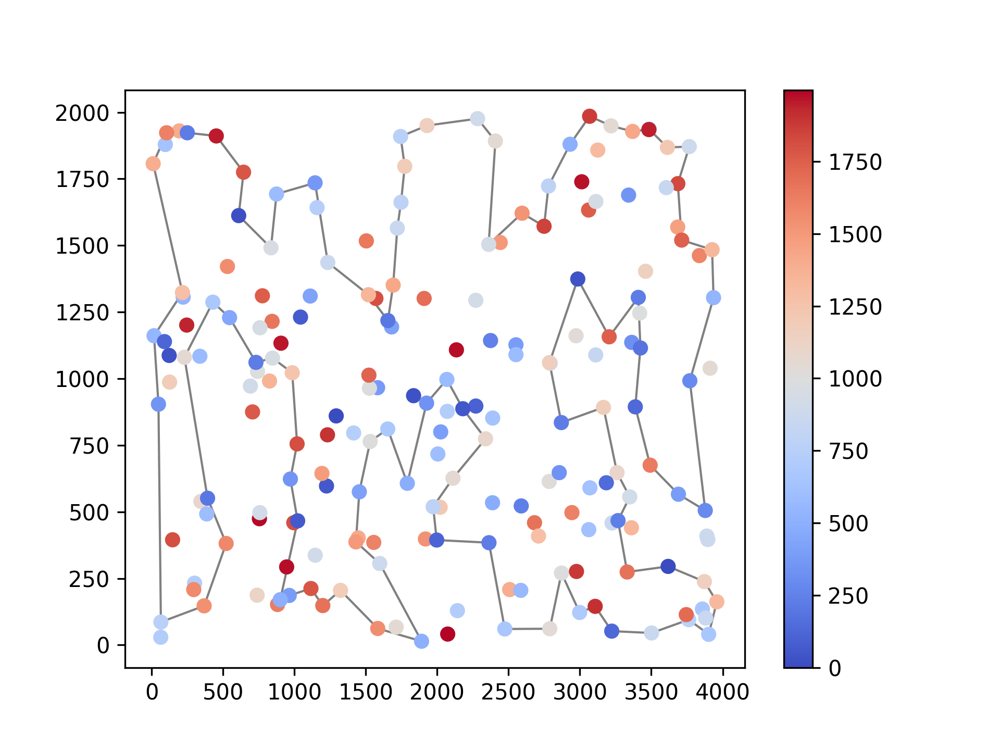
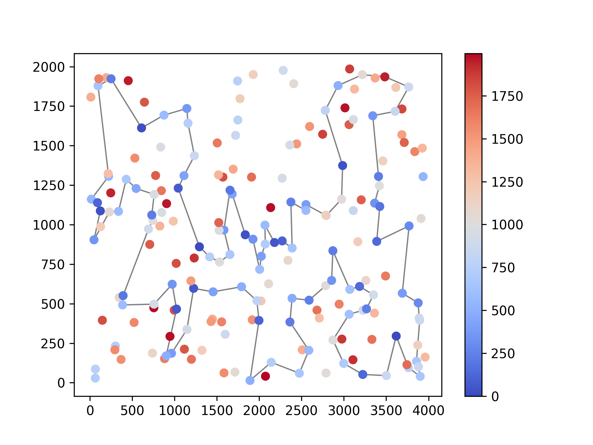
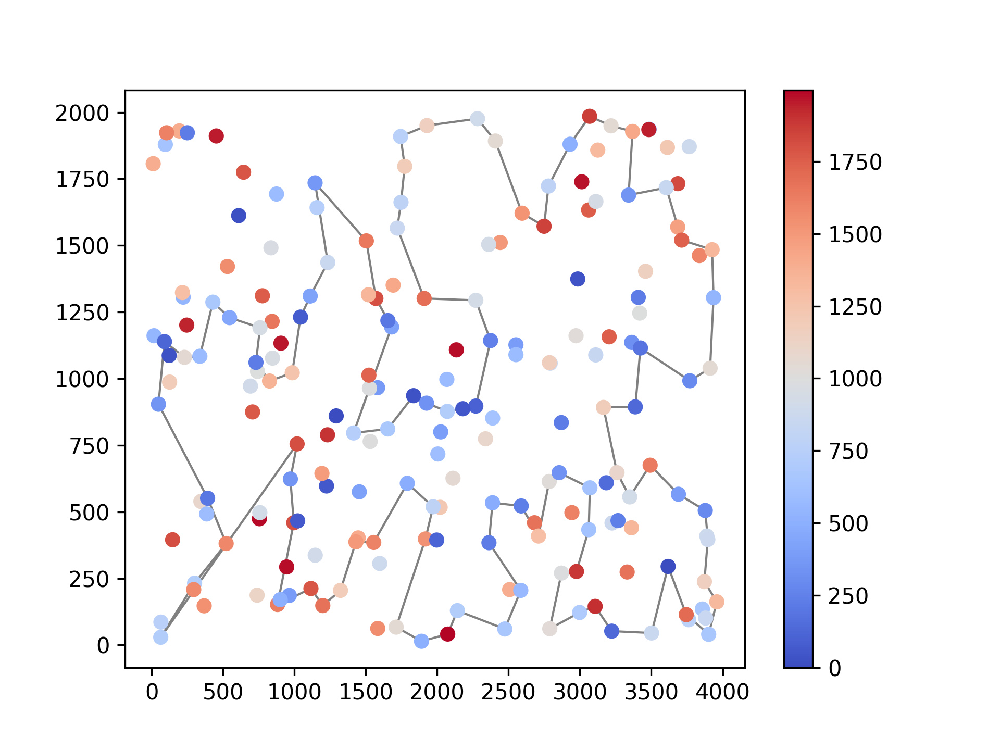
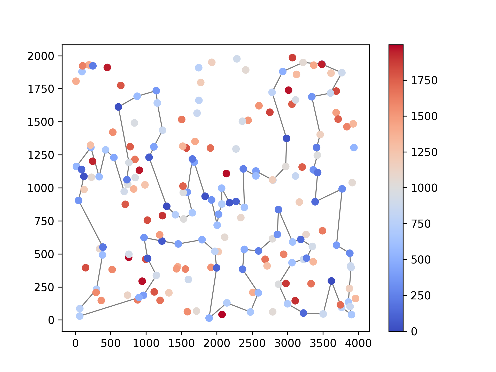
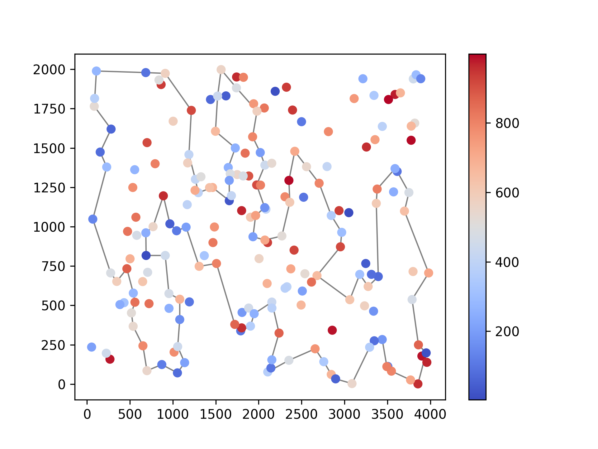
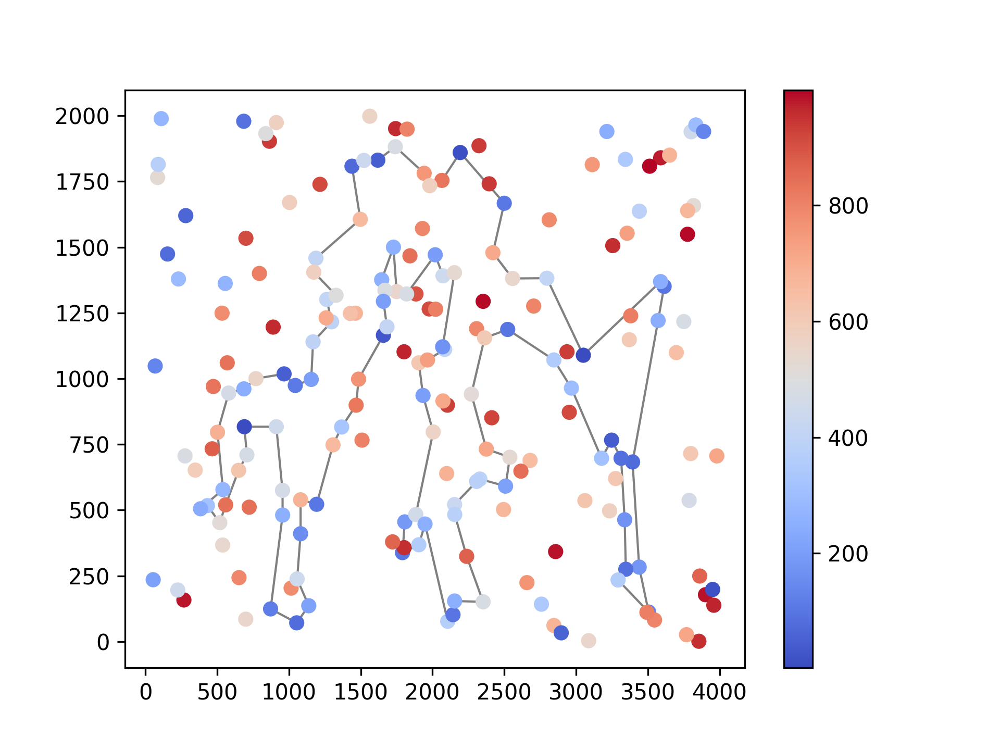
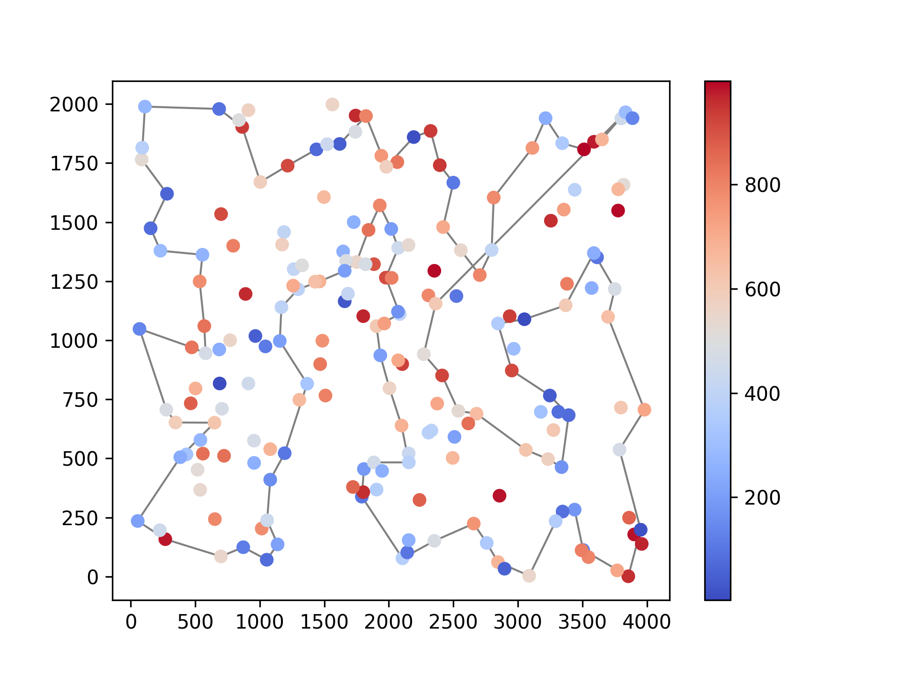
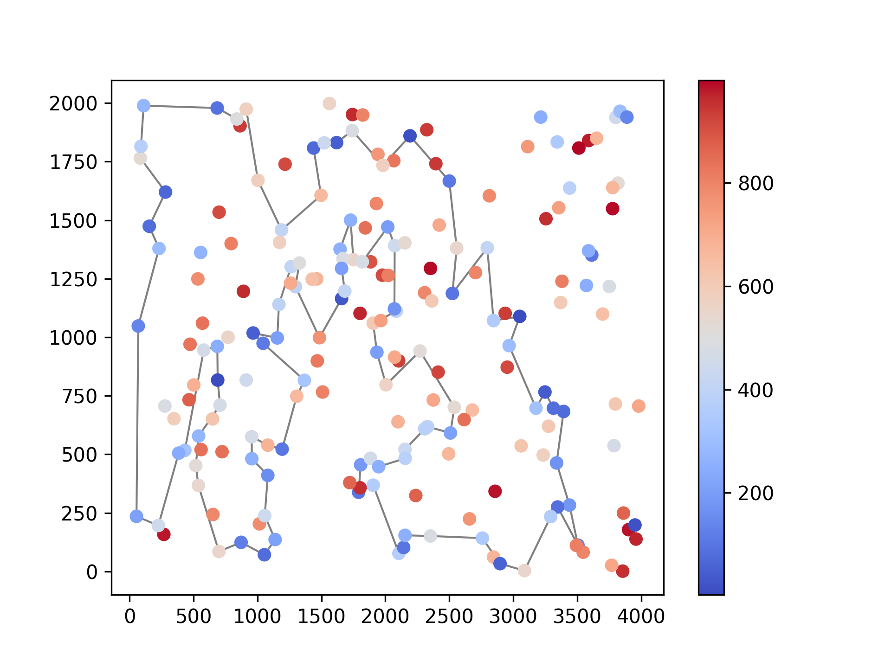

# Lab 2 report

Wiktoria Drabińska 160294, Wojciech Dudziński 160293

## Problem description

We are given three columns of integers with a row for each node. The first two columns contain x
and y coordinates of the node positions in a plane. The third column contains node costs. The goal is
to select exactly 50% of the nodes (if the number of nodes is odd we round the number of nodes to
be selected up) and form a Hamiltonian cycle (closed path) through this set of nodes such that the
sum of the total length of the path plus the total cost of the selected nodes is minimized.

The distances between nodes are calculated as Euclidean distances rounded mathematically to
integer values. The distance matrix should be calculated just after reading an instance and then only
the distance matrix (no nodes coordinates) should be accessed by optimization methods to allow
instances defined only by distance matrices.

## Algorithms

Each implementation is evaluated on every requested instance. The summary statistics below cover all candidate solutions returned by that implementation.

### Greedy Cycle (2-Regret)

```
Input:
matrix - matrix of distances between nodes
costs - array of node costs
start - index of the initial node

to_find = ceil(len(matrix) / 2)
indices = [i for i∊ℕ and i<len(matrix)]

function get_insert_cost(solution, node, idx):
	if idx == 0 or idx == len(solution):
		return matrix[solution[-1]][node] + costs[node] + matrix[node][solution[0]] - matrix[solution[-1]][solution[0]]
	return costs[node] + matrix[solution[idx-1]][node] + matrix[node][solution[idx]] - matrix[solution[idx-1]][solution[idx]]

solution = [start]
while len(solution) < to_find:
	candidates = []
	for node in indices:
		if node not in solution:
			insertions = sorted([(get_insert_cost(solution, node, idx), idx) for idx in range(len(solution) + 1)])
			best_cost, best_idx = insertions[0]
			second_best_cost = insertions[1][0]
			regret = second_best_cost - best_cost
			candidates.append((regret, -best_cost, node, best_idx))
	selected = max(candidates, key=lambda x: (x[0], x[1]))
	solution.insert(selected[3], selected[2])

return solution
```

### Greedy Cycle (Weighted)

```
Input:
matrix - matrix of distances between nodes
costs - array of node costs
start - index of the initial node

WEIGHT = 0.5
to_find = ceil(len(matrix) / 2)
indices = [i for i∊ℕ and i<len(matrix)]

function get_insert_cost(solution, node, idx):
	if idx == 0 or idx == len(solution):
		return matrix[solution[-1]][node] + costs[node] + matrix[node][solution[0]] - matrix[solution[-1]][solution[0]]
	return costs[node] + matrix[solution[idx-1]][node] + matrix[node][solution[idx]] - matrix[solution[idx-1]][solution[idx]]

solution = [start]
while len(solution) < to_find:
	candidates = []
	for node in indices:
		if node not in solution:
			insertions = sorted([(get_insert_cost(solution, node, idx), idx) for idx in range(len(solution) + 1)])
			best_cost, best_idx = insertions[0]
			second_best_cost = insertions[1][0]
			regret = second_best_cost - best_cost
			score = WEIGHT * regret - (1 - WEIGHT) * best_cost
			candidates.append((score, node, best_idx))
	selected = max(candidates, key=lambda x: x[0])
	solution.insert(selected[2], selected[1])

return solution
```

### Nearest Neighbor Full Route (2-Regret)

```
Input:
matrix - matrix of distances between nodes
costs - array of node costs
start - index of the initial node

to_find = ceil(len(matrix) / 2)
indices = [i for i∊ℕ and i<len(matrix)]

function get_insert_cost(solution, node, idx):
	if idx == 0:
		return matrix[node][solution[0]] + costs[node]
	if idx == len(solution):
		return matrix[solution[-1]][node] + costs[node]
	return costs[node] + matrix[solution[idx-1]][node] + matrix[node][solution[idx]] - matrix[solution[idx-1]][solution[idx]]

solution = [start]
while len(solution) < to_find:
	candidates = []
	for node in indices:
		if node not in solution:
			insertions = sorted([(get_insert_cost(solution, node, idx), idx) for idx in range(len(solution) + 1)])
			best_cost, best_idx = insertions[0]
			second_best_cost = insertions[1][0]
			regret = second_best_cost - best_cost
			candidates.append((regret, -best_cost, node, best_idx))
	selected = max(candidates, key=lambda x: (x[0], x[1]))
	solution.insert(selected[3], selected[2])

return solution
```

### Nearest Neighbor Full Route (Weighted)

```
Input:
matrix - matrix of distances between nodes
costs - array of node costs
start - index of the initial node

WEIGHT = 0.5
to_find = ceil(len(matrix) / 2)
indices = [i for i∊ℕ and i<len(matrix)]

function get_insert_cost(solution, node, idx):
	if idx == 0:
		return matrix[node][solution[0]] + costs[node]
	if idx == len(solution):
		return matrix[solution[-1]][node] + costs[node]
	return costs[node] + matrix[solution[idx-1]][node] + matrix[node][solution[idx]] - matrix[solution[idx-1]][solution[idx]]

solution = [start]
while len(solution) < to_find:
	candidates = []
	for node in indices:
		if node not in solution:
			insertions = sorted([(get_insert_cost(solution, node, idx), idx) for idx in range(len(solution) + 1)])
			best_cost, best_idx = insertions[0]
			second_best_cost = insertions[1][0]
			regret = second_best_cost - best_cost
			score = WEIGHT * regret - (1 - WEIGHT) * best_cost
			candidates.append((score, node, best_idx))
	selected = max(candidates, key=lambda x: x[0])
	solution.insert(selected[2], selected[1])

return solution
```

## Results

| | Greedy Cycle | Nearest Neighbor | Nearest Neighbor (all positions) | Greedy Cycle (2-Regret) | Greedy Cycle (Weighted) | Nearest Neighbor Full Route (2-Regret) | Nearest Neighbor Full Route (Weighted) |
| --- | --- | --- | --- | --- | --- | --- | --- |
| **Instance A** |
| Min | 72590 | 84362 | 72328 | 111748 | **72011** | 110950 | 72419 |
| Avg | 73793.4 | 87476.63 | 74346.96 | 120502.05 | **73339.43** | 121360.29 | 75542.49 |
| Max | **75281** | 90075 | 77022 | 129972 | 76027 | 135771 | 78504 |
| Execution time | 172239.77ms | 2377.9ms | 190031.79ms | 30716.49ms | 30881.79ms | 31569.18ms | 31967.62ms |
| **Instance B** |
| Min | 55655 | 56007 | 52915 | 66167 | 52860 | 68761 | **50485** |
| Avg | 59649.91 | 59397.33 | 59475.5 | 72327.22 | 57902.08 | 73649.84 | **55694.15** |
| Max | 63734 | 63166 | 66164 | 77274 | 63406 | 79756 | **61406** |
| Execution time | 165464.06ms | 2384.79ms | 170881.14ms | 32714.95ms | 51646.35ms | 31474.27ms | 30920.19ms |

## TSPA.csv

### Greedy Cycle (2-Regret)

Min: 111748

Avg: 120502.05

Max: 129972

Best solution: `[187, 30, 23, 162, 90, 123, 152, 108, 11, 97, 120, 110, 129, 168, 116, 82, 77, 199, 48, 126, 137, 80, 38, 91, 157, 4, 196, 51, 133, 139, 112, 5, 115, 175, 39, 154, 62, 34, 109, 186, 136, 197, 163, 19, 29, 17, 55, 86, 155, 21, 147, 47, 159, 130, 117, 93, 50, 1, 128, 164, 194, 174, 81, 43, 113, 89, 124, 107, 75, 26, 78, 88, 64, 57, 105, 182, 138, 111, 192, 58, 135, 73, 41, 99, 177, 52, 144, 45, 185, 102, 87, 96, 98, 114, 22, 10, 183, 166, 2, 171]`



Execution time: 30716.49ms

### Greedy Cycle (Weighted)

Min: 72011

Avg: 73339.43

Max: 76027

Best solution: `[60, 116, 149, 63, 168, 11, 49, 108, 152, 100, 123, 83, 160, 97, 127, 161, 30, 187, 171, 2, 189, 141, 87, 45, 73, 135, 114, 181, 192, 158, 58, 84, 134, 72, 176, 174, 150, 106, 113, 89, 42, 151, 138, 182, 57, 64, 107, 88, 78, 193, 153, 75, 170, 146, 159, 130, 47, 93, 50, 3, 169, 1, 178, 101, 55, 29, 163, 136, 186, 164, 142, 8, 9, 54, 33, 131, 36, 177, 52, 179, 53, 140, 144, 67, 16, 51, 35, 185, 102, 28, 180, 132, 76, 4, 71, 157, 91, 80, 48, 31]`



Execution time: 30881.79ms

### Nearest Neighbor Full Route (2-Regret)

Min: 110950

Avg: 121360.29

Max: 135771

Best solution: `[104, 69, 120, 97, 168, 149, 11, 49, 108, 152, 100, 123, 148, 162, 132, 76, 4, 157, 18, 173, 16, 156, 28, 185, 67, 144, 179, 177, 36, 33, 143, 190, 139, 112, 5, 115, 175, 39, 154, 34, 109, 186, 136, 197, 163, 19, 178, 101, 155, 21, 147, 37, 47, 50, 93, 81, 43, 113, 117, 130, 159, 170, 75, 26, 78, 122, 107, 64, 57, 105, 182, 111, 138, 165, 151, 150, 176, 72, 65, 134, 84, 58, 158, 192, 181, 118, 114, 25, 121, 73, 45, 70, 96, 10, 183, 166, 32, 40, 30, 23]`



Execution time: 31569.18ms

### Nearest Neighbor Full Route (Weighted)

Min: 72419

Avg: 75542.49

Max: 78504

Best solution: `[171, 2, 189, 187, 30, 141, 87, 45, 73, 135, 114, 181, 192, 158, 58, 84, 134, 72, 176, 174, 150, 106, 113, 89, 42, 151, 138, 182, 57, 64, 107, 88, 78, 193, 153, 75, 170, 146, 159, 130, 47, 93, 50, 3, 169, 1, 59, 178, 101, 55, 29, 163, 136, 186, 164, 142, 8, 9, 54, 33, 131, 36, 177, 52, 179, 53, 140, 144, 67, 16, 51, 35, 185, 102, 28, 180, 132, 76, 4, 71, 157, 91, 80, 100, 123, 83, 160, 152, 108, 49, 60, 116, 149, 63, 168, 97, 127, 69, 129, 104]`



Execution time: 31967.62ms


## TSPB.csv

### Greedy Cycle (2-Regret)

Min: 66167

Avg: 72327.22

Max: 77274

Best solution: `[196, 114, 148, 143, 131, 118, 68, 110, 23, 93, 9, 188, 14, 20, 74, 17, 171, 39, 99, 163, 88, 82, 126, 152, 167, 51, 85, 107, 49, 33, 47, 140, 154, 161, 26, 125, 170, 97, 155, 141, 60, 157, 45, 134, 175, 62, 91, 36, 197, 5, 6, 102, 103, 178, 65, 145, 28, 149, 13, 37, 116, 42, 195, 130, 30, 21, 168, 69, 172, 133, 120, 63, 198, 58, 48, 156, 166, 72, 46, 109, 184, 173, 151, 111, 27, 135, 0, 79, 185, 144, 162, 192, 106, 84, 150, 80, 52, 90, 78, 41]`



Execution time: 32714.95ms

### Greedy Cycle (Weighted)

Min: 52860

Avg: 57902.08

Max: 63406

Best solution: `[197, 29, 132, 6, 19, 177, 125, 26, 154, 140, 47, 38, 21, 30, 183, 191, 130, 63, 121, 198, 96, 48, 43, 156, 32, 89, 57, 79, 185, 104, 54, 196, 114, 10, 90, 14, 2, 74, 20, 153, 129, 127, 80, 192, 162, 76, 135, 27, 11, 66, 67, 24, 34, 152, 181, 126, 88, 179, 87, 82, 167, 51, 85, 59, 73, 98, 151, 122, 173, 3, 184, 86, 46, 72, 117, 8, 120, 133, 136, 172, 160, 69, 124, 4, 64, 33, 40, 141, 60, 157, 45, 134, 175, 71, 155, 97, 170, 115, 180, 5]`



Execution time: 51646.35ms

### Nearest Neighbor Full Route (2-Regret)

Min: 68761

Avg: 73649.84

Max: 79756

Best solution: `[94, 169, 199, 70, 190, 194, 77, 104, 144, 185, 79, 57, 83, 44, 89, 156, 164, 96, 198, 121, 195, 50, 7, 116, 37, 13, 149, 28, 145, 158, 138, 55, 177, 53, 65, 178, 103, 180, 132, 1, 108, 62, 175, 134, 45, 157, 60, 40, 64, 47, 38, 21, 168, 172, 8, 92, 166, 72, 46, 109, 3, 122, 151, 98, 25, 181, 73, 59, 85, 82, 88, 163, 99, 39, 17, 74, 20, 14, 2, 23, 110, 118, 131, 143, 148, 196, 78, 54, 162, 106, 127, 90, 153, 182, 150, 84, 66, 35, 27, 135]`



Execution time: 31474.27ms

### Nearest Neighbor Full Route (Weighted)

Min: 50485

Avg: 55694.15

Max: 61406

Best solution: `[65, 145, 28, 149, 13, 146, 37, 116, 147, 42, 50, 130, 63, 121, 198, 96, 48, 156, 89, 57, 185, 76, 104, 162, 54, 192, 80, 127, 129, 90, 153, 14, 2, 20, 74, 17, 171, 99, 88, 179, 87, 82, 51, 85, 59, 73, 167, 181, 152, 34, 24, 67, 66, 27, 98, 151, 122, 3, 184, 46, 72, 117, 8, 120, 133, 136, 172, 160, 69, 124, 21, 183, 30, 38, 47, 154, 140, 64, 33, 40, 141, 155, 71, 60, 157, 45, 134, 175, 62, 36, 197, 6, 115, 170, 125, 177, 29, 132, 174, 1]`



Execution time: 30920.19ms


## Conclusions

- Weighted heuristics outperform standard 2-regret across both instances, consistently achieving lower minimum, average, and maximum solution costs.
- Greedy Cycle with the weighted heuristic performs best on Instance A
- Nearest Neighbor Full Route with the weighted heuristic performs best on Instance B
- Standard 2-regret performs considerably worse on both instances, indicating that regret-based insertion 

*All solutions have been verified with the solution checker*

## Source code

[https://github.com/WikiDrabinka/ce/tree/main/py/2](https://github.com/WikiDrabinka/ce/tree/main/py/2)
